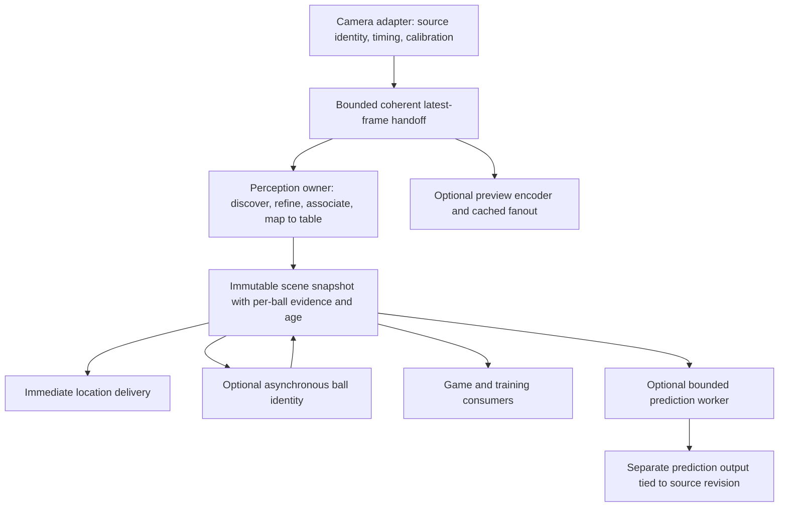

# Architectural review: make fresh, precise ball locations the primary product

Date: 2026-10-19, America/New_York. Reviewed checkout: `e748c0f99e8e8c089633aa282154a05697adb243` plus the existing uncommitted performance-audit changes. This is a review and experiment backlog, not an accepted redesign or production optimization. Existing changes were preserved.

## Judgment

The application should be organized around a small, authoritative perception engine that publishes trustworthy ball observations immediately. Ball-number recognition, cue analysis, physics, training, preview video, and renderers should consume those observations independently.

Today, ownership is spread across Vision, IntegrationService, Core, event managers, transport conversions, and several client implementations. The design gives considerable attention to prediction lifecycle while primary location freshness and physical accuracy have weaker contracts. The most consequential opportunities are execution-backend correctness, observation provenance, capture coherence, calibrated geometry, and isolation of optional work. A wholesale language or transport rewrite is not supported by the measurements.

The requested priority order is:

1. Detect every visible ball quickly and locate it precisely on the physical table.
2. Preserve object continuity and identify numbered balls when the visual evidence supports it.
3. Deliver fresh observations to clients and secondary engines for cues, predictions, and training.

Unknown identity must not delay location publication. Occluded positions and estimated current positions must not be presented as direct measurements. A single camera cannot measure a completely hidden ball or read a numeral facing away from it; the contract must represent that limitation.

## Scope and evidence

The review traced production capture and shared-memory publication, vision/detection/tracking/calibration, IntegrationService and Core, physics scheduling, API/WebSocket delivery, browser clients, Lua renderers/projector transport, configuration, deployment/dependencies, tests, and all eight accepted ADRs. Three independent reviewers challenged capture/vision, runtime/state ownership, and delivery/clients. Source-confirmed behavior is distinguished below from reproduced diagnostics and candidate improvements.

No production behavior was changed, no new long performance run was performed, and no camera, browser, or physical-table accuracy experiment was performed during this review. The existing real-model audit is the performance evidence. The additional local diagnostic loaded the same PT model and processed one recorded frame; it establishes backend selection, not comparative speed.

### Correction to the recent performance interpretation

**The earlier description of the PT audit as verified MPS execution was unjustified.** The detector selects and reports `mps`, but its standard inference call does not pass that choice to Ultralytics. In a fresh diagnostic using the audited model and `demo3.mp4`, the predictor device and model parameters were both **CPU**, while `detector.device` reported **MPS**. The effective predictor `imgsz` setting was `[1280, 1280]`; this is the configured inference size, not a captured input-tensor shape. The model classes were `{0: "cue", 1: "ball"}`. See [diagnostic evidence](performance-audits/architecture-review-diagnostics.json).

Historical runs did not retain actual predictor placement, so this diagnostic does not retroactively prove their exact device. It does reproduce a defect in the same inference path and makes CPU execution the first explanation to verify. The measured delivery rates and latencies remain observations of the system as run. They cannot establish MPS saturation or the superiority of another runtime.

Also, the profiler's `model_execute` span surrounds the Ultralytics call, including work performed inside its wrapper. It is not an accelerator-kernel-only measurement. A 4K source image is not evidence of a 4K model tensor.

| Existing evidence | Result | Architectural implication / limitation |
|---|---|---|
| Three 120-second instrumentation-off receiver runs | Mean 24.19 distinct source observations/s; source-publication-to-receipt p95 92–109 ms; approximately 28.35 state messages/s | Repeated messages inflate apparent update rate. This is software publication onward, excluding unknown sensor/driver age. Distinct source frames do not prove every ball was freshly detected. |
| 300-frame 4K-source replay | 15.31 processed frames/s; processing p95 126.2 ms | The detector path is expensive, but different replay and live paths are not interchangeable benchmarks. |
| Off/on audit comparison | Observed throughput change −13.94%; p95 latency change +71.31% | Exceeds the audit's 2% budget. Ordered runs and sustained drift leave causal attribution uncertain; use interleaved repeats before calling the exact difference instrumentation cost. |
| Instrumented 20-minute soak | 17.83 distinct observations/s; receiver age p95 293 ms; detector-call p95 rose toward 230–238 ms in retained middle-run traces | Sustained behavior matters. Instrumentation interferes, server trace hits its cap, receiver quantiles use bounded history, and the cause of drift remains unproven. |
| Instrumented resource/stage observations | API CPU median ~2.8 cores; event-loop lag p95 178 ms; Core ~1.20 ms, conversion ~0.14 ms, serialization ~0.15 ms, socket write ~1.61 ms at p95 | Investigate interference and detector backend before transport micro-optimization. Do not sum marginal p95s into an end-to-end p95. |
| Eight labeled stills, 52 balls | Detection F1 .972; matched-center error mean 3.77 px, p95 9.11 px | Insufficient evidence for moving-ball accuracy, physical millimeter precision, identity, occlusion, or current-location accuracy. Matching accepts centers within half the labeled radius and center error excludes unmatched balls. |

The audit's “state-only” condition disabled trajectory instrumentation/subscriptions, **not trajectory computation**. Browser rendering, physical display, real-camera exposure-to-result latency, and temporal accuracy were not measured. The interrupted earlier soak remains invalid.

Sources: [findings](performance-audits/findings.md), [off baseline](performance-audits/20261019-205837-3188d1ec/report.md), [on comparison](performance-audits/20261019-210657-c97d5d51/report.md), [corrected soak](performance-audits/20261019-214945-8c5f68d0/report.md).

## Ranked findings

### A1 — Verify execution placement before changing language or model architecture

**Priority: P0. Evidence: reproduced backend mismatch and source-confirmed unused backend path.**

[Device selection](../backend/vision/detection/yolo_detector.py:291) sets a detector field. [Model loading](../backend/vision/detection/yolo_detector.py:539) logs the device without applying it; [standard inference](../backend/vision/detection/yolo_detector.py:1596) supplies the frame and confidence/NMS arguments but no device. An [ONNX CoreML session](../backend/vision/detection/yolo_detector.py:468) is constructed, yet `onnx_session` is never called for inference. Merely listing a provider is also insufficient to establish where every operator executes.

**Opportunity:** make backend selection executable and observable. Record actual predictor device, backend, model hash, effective tensor shape/dtype, preprocessing, output transfer, and fallback. A CPU fallback can be useful, but it must change readiness/quality reporting rather than retain an accelerator success label.

**Benefit:** potentially large detector improvement and reliable runtime comparisons; magnitude is unknown. **Complexity:** low to medium for explicit PT selection; medium for equivalent exported adapters. **Accuracy:** changing backend or precision can change outputs and requires equivalence validation.

**Validation:** compare explicitly selected CPU/MPS and supported CoreML/ONNX paths with the same model, frames, preprocessing, resolution, and output semantics. Measure cold start separately, then warm and sustained operation. Capture actual operation placement, not the requested device string. Do not infer a speedup from a single diagnostic inference.

### A2 — Stop turning repeated observations into apparently new state

**Priority: P0. Evidence: source-confirmed duplicate processing; isolated stale-gate acceptance reproduced.**

[Vision returns its cached result](../backend/vision/__init__.py:684). The [integration polling loop](../backend/integration_service.py:445) processes it repeatedly, [resets receipt time](../backend/integration_service.py:562), and Core assigns [current time and a new frame counter](../backend/core/game_state.py:119). The ball serializer [omits observation timestamp](../backend/integration_service_conversion_helpers.py:197), so Core's `last_update` can become [assembly time](../backend/core/game_state.py:427).

The prediction gate adds elapsed time since the latest poll/request to a [publication-age value frozen in the result](../backend/integration_service.py:875). An isolated diagnostic accepted a source timestamp ten seconds old under a 0.5-second age budget when the stored relative age was .01 seconds and the poll/request was recent. This reproduces the gate defect, not a full camera interruption scenario.

**Opportunity:** make source/session identity and absolute observation time immutable. Admit each observation once; compute age at consumption from comparable clocks. Publish heartbeat and repeated snapshots separately. Expire balls, cue, calibration, and predicted estimates independently, and expose unavailable/stale state while the camera is interrupted.

Provenance should travel inside the snapshot, not as mutable service state attached later. The current [publication path](../backend/integration_service.py:1678) selects balls/cue/table/game type and observation status but omits Core's validity, validation errors and aggregate confidence. Transport-valid data must not lose the reasons the estimator considered it invalid.

**Benefit:** trustworthy freshness and less repeated conversion, Core work, history, and prediction admission. **Complexity:** medium, crossing the observation contract. **Accuracy:** improves honesty; deduplication must allow legitimate independent component updates.

**Validation:** freeze the last result while polling continues, interrupt/restart capture, reset source counters, change calibration, and deliver out of order. Age must increase, unique observations must stop increasing, stale state must be visible, and new predictions must become ineligible. A source restart must create a new session, not collide with old frame numbers.

### A3 — Establish coherent pixels, metadata, and source identity across processes

**Priority: P0. Evidence: synchronization guarantee absent; corruption occurrence not reproduced.**

The [shared-memory publisher](../backend/video/ipc/shared_memory.py:299) describes an atomic switch but writes an entire packed header. Reader attach/detach also [rewrites the same header](../backend/video/ipc/shared_memory.py:362). The [reader](../backend/video/ipc/shared_memory.py:783) obtains the counter, slot, and metadata separately, then copies pixels without a publication-generation recheck or slot ownership. The writer lock is process-local. Triple buffering limits typical contention but does not establish coherent snapshots when a reader is paused or overtaken.

**Opportunity:** define a cross-process protocol with verified synchronization and slot ownership or generation-checked bounded retries. Give the publisher sole ownership of publication fields. Use supported atomic/memory-order primitives or explicit cross-process synchronization; a Python byte assignment is not a portable atomic-publication contract.

**Benefit:** trustworthy detection inputs and frame correlation. **Complexity:** medium to high, especially across platforms. **Accuracy:** critical; corruption can masquerade as model/tracker error.

**Validation:** concurrent writer/readers encode frame ID and checksums into pixels. Inject delays during header access, copying, attach/detach, wraparound, restart, and resolution changes. Every accepted image must agree with its metadata; unstable snapshots must be retried or dropped within a bound. Keep the reader copy until buffer lifetime is proven; zero-copy is a later experiment.

### A4 — Define physical ball position as a calibrated measurement

**Priority: P0 for the precision requirement. Evidence: current representation and measurement gap confirmed; physical error magnitude unmeasured.**

The [primary conversion](../backend/integration_service_conversion_helpers.py:15) explicitly replaces perspective/metric mapping with resolution scaling and [accepts only pixels/canonical pixels](../backend/integration_service_conversion_helpers.py:85). Canonical 3840×2160 coordinates solve an image-scaling problem; they do not establish table-space distances or physical precision. A [table-meter homography already exists](../backend/core/integration.py:68), chiefly used in projector/trajectory context. Calibration is not absent; it is not authoritative on the primary ball-state path.

The detector currently uses [box midpoints](../backend/vision/detection/yolo_detector.py:1645), not a validated physical-center measurement. Shadows, partial visibility, blur, and asymmetric boxes can bias those points. A plane homography also needs evaluation for the apparent center of a raised sphere. No ball-height/parallax correction was found in the inspected production paths; its actual significance depends on camera geometry.

**Opportunity:** retain raw/rectified source coordinates and publish a calibrated table-space center, explicit units/origin, calibration revision, and position uncertainty. Compare a learned center/keypoint model with high-resolution local geometric/segmentation refinement. Treat the table map as invalid when calibration is missing or incompatible, while allowing clearly labeled image observations.

**Benefit:** meaningful location accuracy, camera-independent clients, simpler physical predictions. **Complexity:** high migration; medium for an additive calibrated observation field. **Accuracy:** geometry assumptions and uncertainty need physical validation; refinement is not guaranteed to improve occluded/touching balls.

**Validation:** held-out measured ball placements across the entire cloth, rails and corners; different camera poses and resolutions; touching balls, shadow and glare. Report millimeter error and bias by table region, not just pixels or reprojection round trips. Test ball-center/parallax hypotheses against those measurements. This would require a proposed successor to ADR-0007 before changing its authoritative-coordinate decision.

### A5 — Reorient scheduling toward moving-ball coverage

**Priority: P1. Evidence: policy conflict confirmed; scheduler disabled in the audited baseline.**

The phase scheduler [suppresses ball verification and detailed tracking in MANY_MOVING](../backend/vision/phase_scheduler.py:823). This implements an aiming-first product: wait for motion, then recover the map. It conflicts with continuous location coverage during breaks and collisions. [Current configuration disables it](../config.json:140), so enabling it cannot be assumed to be a safe speed improvement or an explanation of the existing baseline.

**Opportunity:** schedule against per-ball freshness and uncertainty. Drop optional cue, identity, preview, and prediction work first. Compare global discovery plus high-rate local tracking/refinement against a sufficiently fast full-table detector. Use periodic global reconciliation to recover new/teleported balls and ROI misses. Cropping needs recovery paths, visibility checks, and source-coordinate restoration; it cannot become a permanent blind spot.

**Benefit:** useful observations during motion, bounded age, and less unchanged-scene work. **Complexity:** high. **Accuracy:** cheap tracking can drift and miss collisions; lower-resolution models can lose small balls.

**Validation:** dense breaks, high speed, touching/crossing balls, occlusion, manual relocation, settlement, and new balls. Measure missed-ball duration, time to first observation, longest gap, table-space error, and ID continuity. A phase label must never silently authorize dropping the primary requirement. A policy change needs a successor to ADR-0001, preserving its useful trust/recovery safeguards.

Challenge spatial exclusions as well: [marker filtering](../backend/vision/__init__.py:2468) assumes balls cannot occupy marker locations and discards detections there. If a marker lies in a physically reachable region, that assumption creates a blind spot. Verify marker placement and test balls covering markers; static artifacts should not erase possible ball observations.

### A6 — Separate acquisition cadence, source resolution, model resolution, and preview resolution

**Priority: P1. Evidence: production pacing/preprocessing paths confirmed; benefit unmeasured.**

The production video process [uses CameraCapture](../backend/video/process.py:332). It [reads](../backend/vision/capture.py:540), copies/enqueues, then [sleeps approximately a complete frame period](../backend/vision/capture.py:610). Read/decode time is added to the target interval. Depending on the camera backend, this can reduce acquisition cadence or allow driver backlog. Recorded-file replay and hardware acquisition need different pacing semantics.

Motion assessment runs [before analysis resizing](../backend/vision/__init__.py:1789); this is consistent with the 720p candidate failing to improve performance. Several queues and full-frame copies separate acquisition from detection. A BGR 3840×2160 frame is 24.9 MB, or 0.75 GB/s for one full-image pass at 30 fps, before accounting for both sides of a copy; this is a size calculation, not measured memory bandwidth saturation.

**Opportunity:** use source presentation deadlines for replay, sensor-driven acquisition for cameras, bounded latest-frame ownership, and independently selected resolutions for motion, inference, precise crop refinement, classification, and preview. Keep high-resolution evidence where it improves precision rather than making every operation process it.

**Benefit:** lower acquisition/preprocessing cost and age. **Complexity:** medium. **Accuracy:** downsampling and ROI boundaries can lose balls; exposure and motion blur constrain all algorithms.

**Validation:** actual sensor cadence, exposure/driver age where available, queue residency and sustained source age. Compare camera modes with fixed lighting, exposure and field of view, and record requested versus negotiated settings. The recorded-video run cannot establish sensor performance. Consider a different camera or native capture adapter only after this evidence.

### A7 — Make ball-number identity an independent evidence stream

**Priority: P1 for identity; location must ship first. Evidence: generic model and identity losses confirmed.**

The audited model detects generic `ball` and `cue`. The optional [color/stripe classifier is explicitly heuristic](../backend/vision/detection/yolo_detector.py:962), not a validated number recognizer. The [adapter deliberately discards most numbered classes](../backend/vision/detection/detector_adapter.py:84), so a new multiclass model alone would not solve the feature. Returned classifier confidence is [not preserved independently](../backend/vision/detection/yolo_detector.py:1088).

**Opportunity:** publish a stable track identifier, nullable number, identity evidence/confidence, and position confidence as different fields. Classify high-resolution crops asynchronously and combine clear-view evidence over time. Compare joint numbered-ball detection with a separate crop classifier; use color/stripe, visible numerals and temporal continuity as evidence. Inventory constraints may help but must permit unknown, pocketed, missing, and manually moved balls.

**Benefit:** identity without slowing localization or inventing labels. **Complexity:** medium to high, primarily data and evaluation. **Accuracy:** never promote a guessed number to certain identity; number uncertainty must not fragment location tracks.

**Validation:** all numbered balls, alternative ball sets, lighting, spin, glare, occlusion, similar colors and solid/stripe pairs. Report class confusion, confident wrong identities, unknown rate, time to identify, and continuity through collisions. Keep test recordings independent of training data. OCR alone cannot recover a hidden numeral.

### A8 — Distinguish measured positions, filtered positions, and extrapolation

**Priority: P1. Evidence: timing and filtering choices confirmed; their error unmeasured.**

[Tracking receives processing-entry monotonic time](../backend/vision/__init__.py:1990), so variable queue delay affects its motion interval. It returns filtered/confirmed/lost tracks and [hides tentative observations](../backend/vision/tracking/tracker.py:763); `min_hits=3` adds multiple observations before a new object appears. Lost predictions are usefully marked `is_observed=False`. Association and constant-acceleration filtering warrant challenge around collisions and ambiguous identity.

**Opportunity:** retain the raw center measurement and its source time, a filtered estimate, and any extrapolated current estimate separately. Let consumers choose the appropriate representation. Do not wait for persistent identity confirmation before exposing a clearly labeled tentative location. Propagate calibrated uncertainty and visibility instead of treating model confidence as a spatial error bar.

**Benefit:** reduced hidden lag and honest current-position claims. **Complexity:** medium. **Accuracy:** unsmoothed observations can jitter and tentative false positives need explicit status; filters can improve noise but bias fast changes.

**Validation:** source-timed trajectories, collisions, accelerating/decelerating balls, rapid appearance and occlusion. Compare positional error and temporal lag, not visual smoothness alone. Measure identity switches separately from semantic number recognition.

### A9 — Make perception independent of game state, physics, and optional consumers

**Priority: P1. Evidence: coupling confirmed; performance benefit requires isolated runs.**

Integration [constructs its own trajectory calculator](../backend/integration_service.py:243), performs trajectory admission [after every Core update](../backend/integration_service.py:579), and uses the default executor via `to_thread`. Core uses [the default executor](../backend/core/__init__.py:242) too and [holds its state lock across updates, serialization, and event emission](../backend/core/__init__.py:211). Core's physics/prediction/assistance flags are declarations rather than a reliable workload-off path. Additional histories, event managers, threads and per-event tasks complicate ownership and lifecycle.

**Opportunity:** the perception owner publishes an immutable scene snapshot before game analysis. Game state, trajectories, training, and external publishing consume it through explicit bounded policies. Introduce real workload-level switches and resource budgets. Preserve the existing one-active/one-latest-pending prediction contract, detached inputs, revision checks, shutdown draining and frozen-shot lifecycle. Test a dedicated executor and then process isolation if justified by measured Python CPU/GIL interference.

**Benefit:** prevents secondary work from compromising fresh locations and makes the baseline meaningful. **Complexity:** medium to high. **Accuracy:** source/revision checks and lifecycle preservation are essential. Core's measured ~1.2 ms p95 does not make this the largest throughput opportunity today.

**Validation:** identical location-only, prediction-enabled, prediction-heavy, and slow-consumer workloads with fixed logging. Check per-stage wait, loop lag, primary age, queue/task bounds, restarts and exactly one subscription per lifecycle. Audit switches and workload switches must be named separately.

### A10 — Isolate preview encoding and consolidate client semantics

**Priority: P1 for reliable delivery; preview magnitude unmeasured. Evidence: active source paths confirmed.**

Each MJPEG viewer [copies a frame and synchronously JPEG-encodes it on the API event loop](../backend/api/routes/stream.py:820). [Requested preview dimensions are ignored](../backend/api/routes/stream.py:543). This makes optional viewer count affect resources needed for state delivery. WebSocket state and MJPEG images also advance independently, so apparent overlay alignment is not an accuracy test.

Client implementations diverge. [LiveView](../frontend/web/src/components/video/LiveView.tsx:68) implements a raw socket without application heartbeat/reconnection/resubscription, whereas the backend [expects ping activity and expires connections](../backend/api/websocket/handler.py:1143). This is a source-supported disconnect risk; no browser reproduction was performed. Reusable [VideoStore mapping](../frontend/web/src/stores/VideoStore.ts:706) infers numbers from track IDs and [uses receipt time](../frontend/web/src/stores/VideoStore.ts:735); direct LiveView correctly respects the explicit number and observed fields. Other clients have their own assumptions.

**Opportunity:** encode one reduced-resolution preview per bounded profile in a separate worker, fan out newest encoded bytes, and create it only on demand. Keep one versioned perception contract with common fixtures and a shared browser session implementation. Every client must advance observation age locally, expire stale overlays, distinguish transport sequence from source identity, and retain unknown identity. Browser and backend monotonic clocks cannot be compared directly.

**Benefit:** viewer isolation and correct long-running client behavior. **Complexity:** medium. **Accuracy:** rendering must not silently smooth, extrapolate, or relabel observations. Source-keyed diagnostic preview must not delay the immediate location stream.

**Validation:** 0/1/3 preview clients, one stalled client, background browser, connection/API/camera restarts, arbitrary track IDs, unknown numbers, old calibration and out-of-order snapshots. Match preview source identity where a synchronized overlay is required. Apply bounded newest-state/sequence/expiry semantics to the retained UDP projector too.

### A11 — Treat calibration compatibility as part of the observation contract

**Priority: P1 correctness. Evidence: unchecked compatibility/fallback paths confirmed; recent failure not demonstrated.**

[Undistortion initialization](../backend/video/process.py:244) uses stored intrinsics at the current frame dimensions without checking/scaling the recorded calibration resolution. [Failure falls back to raw pixels](../backend/video/process.py:304). Raw, rectified, resized, cropped, table, and projector coordinates must be distinguishable even when their numerical ranges overlap.

**Opportunity:** validate sensor mode/crop/resize against calibration, bind rectification and table calibration to an immutable revision, and report incompatible/failed geometry explicitly. Keep previous snapshots tied to their old coordinate frame. Recalibration invalidates spatial overlays and predictions.

**Benefit:** avoids plausible-looking but wrong precise locations. **Complexity:** medium. **Accuracy:** central to physical accuracy; do not continue advertising calibrated precision after a raw-frame fallback.

**Validation:** changed capture mode, mismatched intrinsics resolution, remap failure, camera movement, calibration replacement during processing, and restart. Verify revision consistency from pixels to client; assess held-out physical errors after each supported mode.

### A12 — Repair the evidence and release gates that would choose the redesign

**Priority: P1 enabling work. Evidence: audit/gate gaps confirmed.**

The audit currently has excessive observed off/on differences and truncates sustained traces. Its [exporter](../backend/performance_audit.py:105) still takes locks/builds envelopes on producers, and the [writer opens a file for each event](../backend/performance_audit.py:186). An asynchronous queue prevents disk backpressure but does not make instrumentation free.

The then-current Python profile replay synchronously read and processed every
frame, waiting only when ahead of presentation time. When overloaded it fell
behind rather than reproducing independent live capture/latest-frame dropping.
It was retired under ADR-0085 along with the Python live collector; its
limitation informed the separate Rust recorded-video replay proposal in
ADR-0084. Do not treat its historical runs as current live-freshness evidence.

The last full backend run passed 1,145 tests with one skipped but achieved **47.10% coverage against the configured 80% gate**. Formatting, lint and typing passed then. These are prior validation results, not newly rerun during this documentation review. The default [frontend build masks failures with `|| true`](../frontend/web/package.json:8), and CI primarily checks backend paths. Still-image and synthetic tests do not establish real temporal precision.

Runtime metric names need review too: [Vision's `detection_accuracy["balls"]`](../backend/vision/__init__.py:2018) is computed as detected count divided by maximum table capacity. That is an occupancy ratio, not accuracy. A correct one-ball table must not look less accurate than a rack of false positives; reserve accuracy claims for labeled comparisons.

**Opportunity:** retain unsampled cheap counters, sample detail per observation, batch export, preserve bounded tail/summary information, and interleave instrumentation conditions to separate overhead from sustained drift. Establish model-dependent replay and physical/temporal acceptance datasets. Test real adapters instead of reproducing their logic inside tests. Add strict frontend and shared contract gates.

**Benefit:** prevents choosing a fast but inaccurate or unrepeatable architecture. **Complexity:** medium, with significant annotation effort. **Accuracy:** report unmatched balls, selection bias, physical error, gaps, identity and unknowns alongside latency.

**Validation:** randomized/interleaved off/on repetitions; zero-loss summary counters with disclosed trace losses; configured coverage and frontend gates; production-pipeline replay; real-camera field validation. A speed candidate must preserve or improve the declared accuracy/freshness envelope.

### A13 — Represent detector failure separately from a successful empty observation

**Priority: P0 correctness. Evidence: failure-to-empty conversion confirmed in source; no production outage reproduced.**

[Standard inference catches errors and returns an empty list](../backend/vision/detection/yolo_detector.py:1689). [Ball detection also returns an empty list for an unloaded model or caught error](../backend/vision/detection/yolo_detector.py:890), and the classification wrapper propagates that empty list. Vision can then [mark the attempted observation successful](../backend/vision/__init__.py:2003) because no exception reaches its outer failure handler. An empty detection result is therefore ambiguous: genuinely empty image, missed/occluded balls, unavailable model, or inference failure.

**Opportunity:** a typed detector outcome should carry success/failure, source identity, coverage/visibility and detections separately. Retain old observations with advancing age when inference fails; do not turn failure into new evidence that balls disappeared. Pocket/removal decisions need corroborating scene evidence, not an empty list alone.

**Benefit:** prevents apparent empty tables and misleading freshness/health during detector faults. **Complexity:** medium because outcome semantics cross adapters and the estimator. **Accuracy:** essential to completeness and disappearance reasoning.

**Validation:** inject model-unavailable and inference exceptions alongside successful empty-table frames and partial occlusion. Require distinct statuses, stable source accounting, explicit degraded health and no invented fresh negative observations. Preserve restart recovery and bounded latest-work behavior.

## Runtime, libraries, transport, and deployment

| Decision to challenge | Assessment | Evidence required to change it |
|---|---|---|
| Python orchestration | Keep provisionally. Native inference/image kernels can dominate; current device-selection defect comes before a rewrite. CPU-heavy Python prediction work can still interfere through the GIL and shared resources. | Profile Python/native/device time and compare an isolated worker with an equivalent native component. Change the hot component if warranted, not the entire API and training stack. |
| PyTorch/Ultralytics online inference | Keep as the reference implementation, not an assumed fastest deployment backend. Make its actual device and preprocessing explicit. Avoid wrapper defaults deciding production tensor shape/placement invisibly. | Equivalent PT CPU/MPS, exported CoreML/ONNX or platform backend, sustained freshness and accuracy. No assumed CoreML/ONNX multiplier. |
| C++/Rust/Swift | Credible bounded components for capture, buffer ownership, preprocessing or inference. They do not automatically accelerate the same neural graph. Swift/CoreML is platform-specific; C++/Rust carry integration/maintenance costs. | A measured bottleneck survives backend and scheduling correction and a component prototype improves full-path age without accuracy loss. |
| OpenCV | Reasonable image-processing baseline. Its capture abstraction does not guarantee every backend honors FPS/buffering/exposure controls. Retain a replaceable capture interface with actual negotiated properties. | Source age/driver buffering or timestamp evidence justifies AVFoundation, Media Foundation, V4L2, GStreamer or a camera SDK adapter on the relevant platform. |
| YOLO as discovery/localization | Useful baseline, not a requirement. A center/keypoint/segmentation head or hybrid local refinement may fit precision better. Newer/larger models are not automatically better. | Held-out table-space and temporal accuracy versus latency/power on the deployment hardware. |
| Kalman smoothing | A state-estimation tool, not proof of accurate direct observation. Constant-acceleration assumptions are weak at collisions and occlusion. | Separate raw/filtered/current estimates and compare error, lag and uncertainty across collision clips. |
| JSON/WebSocket state | Retain initially. Current small-payload costs are minor; bounded per-client writers are appropriate. Consider serialize-once fanout later where client filters match. | Identical payload/freshness semantics with measured serialization/copy/queue costs and many-client workloads. Binary/UDP/gRPC alone does not resolve stale observations. |
| Shared-memory frames | Appropriate candidate for bulk local images, but correctness protocol must be fixed/proven. Small scene snapshots can use direct in-process handoff or bounded local TCP depending on process ownership. | Coherent snapshot stress tests followed by copy/transport comparisons on identical inputs. Avoid a distributed broker for one table without a demonstrated requirement. |
| Container/native equivalence | Rejected as an assumption. Docker installs CPU-only Linux PyTorch; native macOS acceleration is a different deployment profile. The local diagnostic also exposes misleading native accelerator labels. | Explicit locked per-platform profiles and separate sustained qualification. Default same-machine/cross-platform contracts can coexist with optional platform-specific acceleration. |
| Dependency organization | Several overlapping requirements files, pyproject/lock definitions and unpinned Docker install lists undermine reproducibility. The main pyproject omits important inference packages used by production. | One authoritative dependency definition with locked platform/model profiles; record effective package versions, not just Python and model path. |
| More API workers/microservices | Multiple API workers do not safely parallelize the singleton camera/table owner. Additional processes are useful at specific contention/failure boundaries, not as a universal scale strategy. | One perception owner per table; explicit worker restart/state ownership and bounded IPC. Only distribute tables/clients when requirements justify it. |
| Multiple renderer/client stacks | Keep only those with a product purpose; renderer-specific adapters should consume the same observation schema. UI framework choice is not the detector bottleneck. | Cross-client fixtures and lifecycle/freshness tests. Consolidate contracts before contemplating a wholesale UI rewrite. |

Runtime references checked against primary documentation: [Python thread/GIL caveat](https://docs.python.org/3.10/library/asyncio-task.html#asyncio.to_thread), [Ultralytics inference sizing/device arguments](https://docs.ultralytics.com/modes/predict/), [ONNX Runtime CoreML options and shape constraints](https://onnxruntime.ai/docs/execution-providers/CoreML-ExecutionProvider.html), [provider fallback performance](https://onnxruntime.ai/docs/performance/tune-performance/troubleshooting.html), [Apple operation-placement/performance reports](https://developer.apple.com/documentation/coreml/analyzing-a-core-ml-model-s-performance-in-xcode), and [OpenCV capture property layers](https://docs.opencv.org/4.6.0/d8/dfe/classcv_1_1VideoCapture.html). These establish capabilities/caveats, not performance on this model. Use installed-version behavior when selecting concrete API arguments.

## Proposed ownership and data flow

This is a logical architecture. It does not require a process for every box. Begin with explicit ownership and budgets; add process boundaries where measured contention or fault isolation justifies them. Identity results are versioned annotations on the same track/session; they must not mutate a published snapshot or create new measured locations.

The scene contract should contain a schema version; source/session/frame identity; capture/exposure time only if supplied and trustworthy; software publication and observation times with clock kind/domain; calibration/rectification revision; completeness and health; and per-ball track ID, source image measurement, calibrated table center, measured/filtered/estimated status, last actual observation time, visibility, uncertainty, nullable number and independent identity confidence. Each publication gets its own transport sequence without replacing observation identity. Predictions carry their parent scene identity and expire on invalidation.

Do not require a trusted cue or a complete numbered inventory to publish ball positions. If calibration is unavailable, expose image observations honestly rather than fabricating physical certainty. Preserve partial measurements while representing which balls are missing, uncertain, hidden, or only estimated.

Latest-state delivery intentionally skips intermediate snapshots for slow consumers. If training needs complete collision trajectories or post-shot reconstruction, record source evidence and timestamped observations through a separate bounded, loss-reporting recorder. The live stream's coalescing contract cannot guarantee complete history.

## Accuracy and freshness acceptance

The present 50 ms README goal is a reference, not an achieved result or a substitute for a product-specific accuracy requirement. Set physical precision and timing together for settled tables, aiming, and moving scenes.

| Property | Required measurement |
|---|---|
| Position accuracy | Table-space center error in millimeters, p50/p95/p99, worst region, and systematic bias; include missed detections separately. |
| Scene completeness | Per-frame recall, fraction of fully covered visible tables, false positives, longest missed-ball interval, time to first detection and reacquisition. |
| Freshness | Age from actual observation to publication/receipt, per ball and component; source-publication age separately when sensor time is unavailable. |
| Moving coverage | Unique observed ball positions/s, longest update gap, source-time continuity, collisions and dense-motion coverage. |
| Identity | Number confusion/precision/recall, confidence calibration, unknown rate, time to reliable identity, ID switches and track fragmentation. |
| Resource isolation | Primary age/accuracy with prediction off/on, previews and slow consumers; bounded tasks, queues, memory and measurement loss. |
| Sustained behavior | Repeatable warm runs and a soak, actual backend/tensor provenance, thermal/power context where available, late-run quantiles and failures. |

At constant speed, age contributes approximately `speed × age` displacement before any detector error. For illustration, 100 ms at 1 m/s is 100 mm. This is not a measured ball speed; it shows why a low box-center pixel error cannot establish an accurate current location. Extrapolation can reduce age-related display error in some motion, but collisions make it uncertain and it must remain labeled as estimation.

A single 30 fps camera also has a 33.3 ms sampling interval. Faster inference alone cannot recover observations between frames or remove exposure blur. Evaluate sensor cadence, exposure, optics, overhead geometry and lighting after establishing the current capture/backend facts. Multiple cameras may be justified by an explicit occlusion requirement, but add synchronization, calibration and association cost; they are not the first optimization.

## Relationship to accepted architecture decisions

| ADR | Review |
|---|---|
| 0001 phase scheduling/lifecycle | Preserve trust, latest-frame work and prediction freeze; propose superseding perception cadence policy because MANY_MOVING coverage conflicts with the new priority. Currently opt-in. |
| 0002 background prediction | Preserve detached requests, bounded pending work, revision rejection and draining; fix absolute freshness and make compute independently optional. Test stronger isolation. |
| 0003 bounded WebSocket delivery | Retain. It directly supports fresh primary state and slow-client isolation. Recording history is a separate concern. |
| 0004 validated atomic config | Retain. Consolidate effective settings and apply/observe runtime changes explicitly; a supported schema key must not imply a functioning workload switch. |
| 0005 rate limiting / one owner | Retain one table owner. Redis admission does not distribute scene state. Remote exposure also needs an explicit control-plane authorization boundary. |
| 0006 API models | Retain domain/transport separation but move immutable observation provenance through conversions and add cross-client fixtures; valid transport syntax is not semantic correctness. |
| 0007 image scaling | Retain explicit image metadata; propose an additive calibrated physical observation contract, with a successor if the authoritative domain changes. Existing canonical pixels remain useful derived geometry. |
| 0008 opt-in audit | Retain bounded/default-off design; observed overhead and trace truncation do not satisfy its acceptance intent. Actual backend provenance and production replay fidelity need strengthening. |

No ADR was changed to accepted by this review. The architecture choices above remain proposals pending the named experiments.

## Recommended execution order and next detailed review

1. **Establish truth:** actual backend/tensor placement; immutable source time/session; duplicate/stale handling; coherent shared-memory snapshots; detector failure versus successful empty observations. Add direct failure tests before performance tuning. Correct the old MPS interpretation.
2. **Establish a trustworthy baseline:** real workload switches, low-interference counters, interleaved off/on runs, independent paced production replay, and a small temporal/physical acceptance set.
3. **Improve the perception path:** explicitly selected accelerated backend, acquisition pacing, motion/preprocessing resolution, table ROI plus high-resolution center refinement versus a better center detector. Select only from measured accuracy/freshness results.
4. **Isolate optional engines:** identity, cue, predictions and preview, while preserving latest-work scheduling, slow-client behavior and prediction lifecycle.
5. **Unify the client contract and qualify deployment:** common source/identity/freshness semantics, heartbeat/recovery, strict release gates, reproducible platform profiles. Revisit compiled components and transport only if a remaining measured bottleneck warrants them.

The next level down should begin with A1–A4 and A13: trace the exact production frame-to-observation path, design the timestamp/buffer/coordinate/outcome contracts, and specify failing acceptance tests. That work determines whether later optimization produces faster correct measurements rather than merely more state messages.
