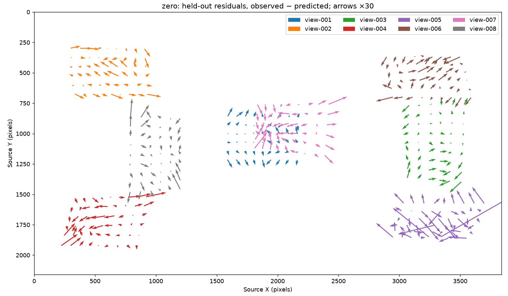
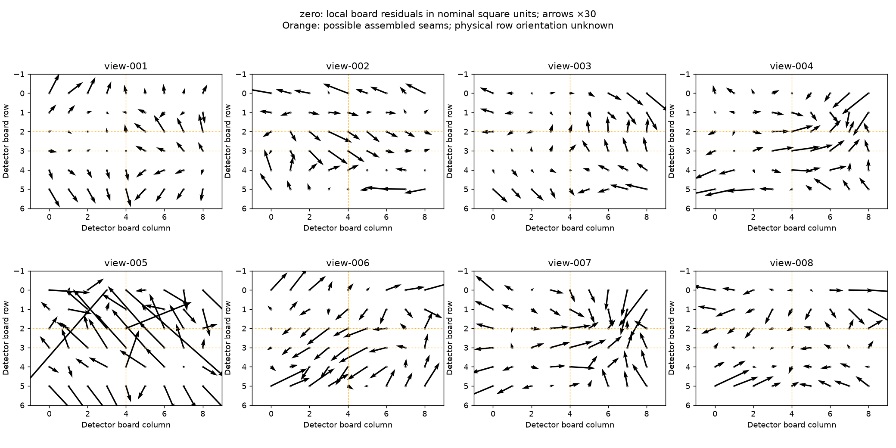
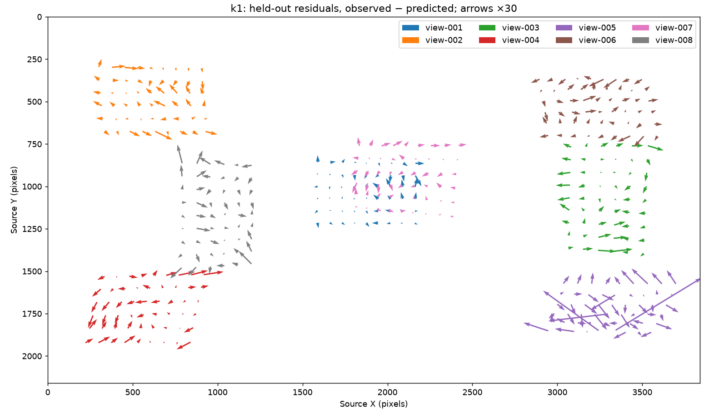
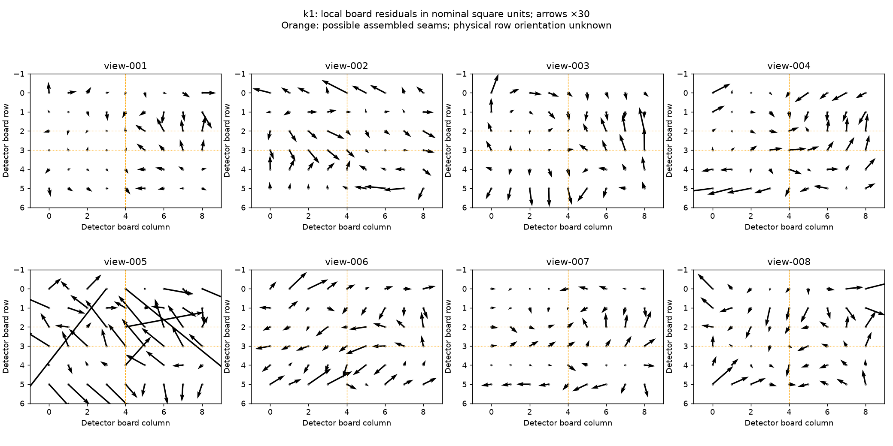
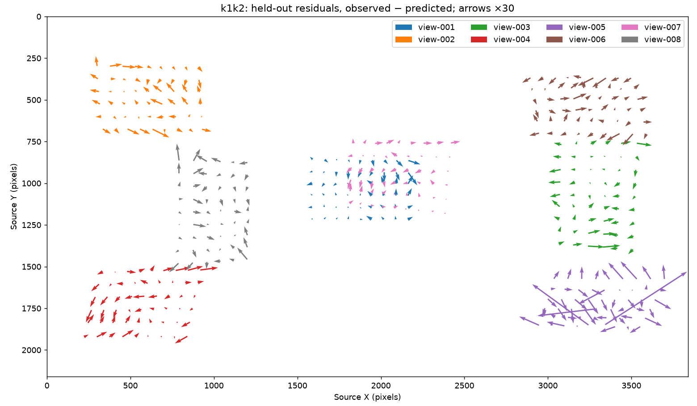
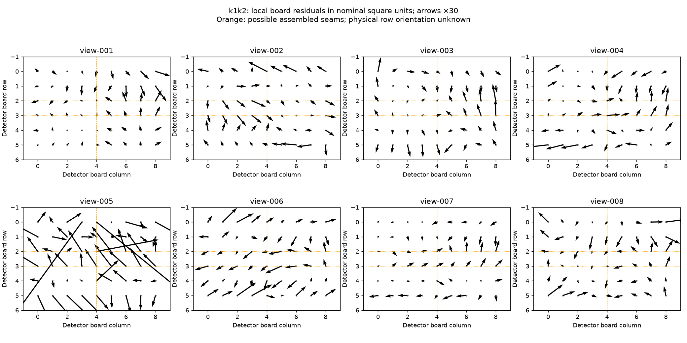
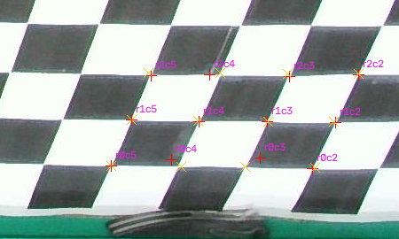
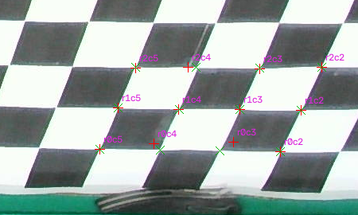

# Larger-board optical model evaluation — 2026-10-28

Eight saved 3840 × 2160 captures; nominal 50.8 mm checkerboard pitch. Exploratory evidence only: assembled print scale and rigid flat backing remain unverified. No camera access or production asset activation.

## Unchanged model and validation policy

Hold out entire view from intrinsics/lens fit; estimate its pose on checkerboard parity 0, score parity 1; swap and concatenate.

Reuse the existing fixed solver defaults: 100 iterations, epsilon 1e−9, fixed tangential/higher-order terms, minimum six views, maximum fold focal relative range 0.25 and principal range fraction 0.1. All eight leave-one-view-out folds use seven training views. No coefficients are tuned from the holdout scores.

| Model | Full-fit RMS px | Holdout RMS px | Holdout p95 px | Holdout max px | Old RMS scaled to 4K px | Successful folds | Fold instability |
|---|---:|---:|---:|---:|---:|---:|---|
| zero | 2.1509 | 2.5044 | 4.1497 | 20.4881 | 0.6443 | 8/8 | False |
| k1 | 1.9120 | 2.0832 | 3.1661 | 19.7714 | 0.6569 | 8/8 | False |
| k1k2 | 1.8953 | 2.0889 | 3.1335 | 19.4792 | 0.6628 | 8/8 | False |

## zero

Full-fit issues: none under configured plausibility bounds

Fold intrinsics: `{"columns": ["fx", "fy", "cx", "cy"], "min": [1881.7568464507765, 1848.3481947987045, 1887.6267972492262, 1044.3320788748479], "max": [2278.6721415406523, 2247.939899143606, 2019.9389071373866, 1080.9957150968155], "stddev": [111.63898504254799, 109.8943707054345, 44.30055425008301, 10.539863674135319], "focal_relative_range": [0.1890585846076283, 0.19315233482665717], "principal_range_fraction_image": [0.03445627861670844, 0.01697390565831835]}`

| Held-out view | RMS px | p95 px | Max px | Fit warnings / failures |
|---|---:|---:|---:|---|
| view-001 | 1.4272 | 2.3291 | 2.7280 | none |
| view-002 | 1.9038 | 3.3060 | 3.8674 | none |
| view-003 | 1.7498 | 2.9373 | 4.3846 | none |
| view-004 | 2.3071 | 4.1895 | 5.6421 | none |
| view-005 | 4.6456 | 7.5100 | 20.4881 | none |
| view-006 | 2.2065 | 3.5856 | 4.7359 | none |
| view-007 | 2.4152 | 3.6951 | 5.5419 | none |
| view-008 | 1.9613 | 3.5916 | 5.0577 | none |





| Detector row | Mean nominal board residual X/Y (square units) | RMS source px |
|---|---|---:|
| 0 | [0.0032769140993844825, 0.004709447750988583] | 3.7865 |
| 1 | [-4.4547455613202655e-05, 0.008091333942033168] | 1.9332 |
| 2 | [-0.00031206855613542914, -0.007331809414728692] | 2.3321 |
| 3 | [-0.001686373061140308, -0.008250009726022484] | 2.0741 |
| 4 | [-0.0011135723379111573, -0.0012314474990920688] | 1.7785 |
| 5 | [0.0002287210616242243, 0.003622861996061746] | 2.5795 |

| Detector column | Mean nominal board residual X/Y (square units) | RMS source px |
|---|---|---:|
| 0 | [-0.005139631229386095, -0.001923543562407066] | 2.6678 |
| 1 | [-0.00069873794198042, 0.0005106911688560889] | 1.7788 |
| 2 | [0.002207504430269993, 0.00013453470883750072] | 1.8558 |
| 3 | [0.0020836277438523597, 0.004357396853371662] | 3.5026 |
| 4 | [0.011109147373960362, 0.0027691381610617243] | 3.1224 |
| 5 | [-0.007601691398702406, -0.0014982252169393126] | 2.0269 |
| 6 | [-0.00313077755484299, -0.003095299656396587] | 2.1056 |
| 7 | [-0.001533773083998185, -0.0020419222444588037] | 2.0491 |
| 8 | [0.0032279422861402987, 0.00020279536193516847] | 2.8221 |

## k1

Full-fit issues: none under configured plausibility bounds

Fold intrinsics: `{"columns": ["fx", "fy", "cx", "cy"], "min": [1657.1886032052662, 1638.7051449281735, 1927.294793032874, 1045.1683363815616], "max": [1795.9538456434784, 1776.4664515322206, 2012.4572528470235, 1075.3787158644266], "stddev": [40.92017658604371, 40.948108805599325, 23.69278378900651, 8.02934233573563], "focal_relative_range": [0.0787336095228665, 0.07893251007193339], "principal_range_fraction_image": [0.022177723909934777, 0.013986286797622656]}`

| Held-out view | RMS px | p95 px | Max px | Fit warnings / failures |
|---|---:|---:|---:|---|
| view-001 | 0.9862 | 1.8114 | 2.4255 | none |
| view-002 | 1.5250 | 2.5883 | 3.7682 | none |
| view-003 | 1.6884 | 2.9322 | 3.8358 | none |
| view-004 | 1.7486 | 3.1509 | 3.9304 | none |
| view-005 | 4.3388 | 7.6698 | 19.7714 | none |
| view-006 | 1.5756 | 2.7650 | 3.2270 | none |
| view-007 | 1.1488 | 1.8655 | 2.1942 | none |
| view-008 | 1.6983 | 2.9163 | 3.7840 | none |





| Detector row | Mean nominal board residual X/Y (square units) | RMS source px |
|---|---|---:|
| 0 | [0.003973717765209494, 0.0026407602797316795] | 3.3170 |
| 1 | [9.948674839376996e-05, 0.007510938998607779] | 1.4738 |
| 2 | [-0.0004598820735021523, -0.007510286397927873] | 2.1176 |
| 3 | [-0.0020121094070120974, -0.008200334375227075] | 1.6340 |
| 4 | [-0.0014874651092624377, -0.0005657065752128103] | 1.3335 |
| 5 | [-9.424588366964709e-05, 0.005837755692894393] | 1.9828 |

| Detector column | Mean nominal board residual X/Y (square units) | RMS source px |
|---|---|---:|
| 0 | [-0.0037731678569355998, -0.005680966864937904] | 1.8522 |
| 1 | [0.0014783678746906814, -0.0001000142998948351] | 1.3617 |
| 2 | [0.0033034760676006734, 0.001528692496100443] | 1.5741 |
| 3 | [0.001504890142248745, 0.007126864279072912] | 3.2207 |
| 4 | [0.008885537578330686, 0.005762777607141083] | 2.9899 |
| 5 | [-0.010998207194547244, 0.0009563432619908166] | 1.6116 |
| 6 | [-0.006031854467209988, -0.002213285552227727] | 1.6852 |
| 7 | [-0.0023062434168550703, -0.003381161018624692] | 1.5480 |
| 8 | [0.007966454332912506, -0.004429558474320964] | 2.0369 |

## k1k2

Full-fit issues: none under configured plausibility bounds

Fold intrinsics: `{"columns": ["fx", "fy", "cx", "cy"], "min": [1713.1810270741798, 1696.1434078554398, 1915.0019534240823, 1045.4189380826958], "max": [1865.7711559390646, 1851.4199162713776, 1986.8562033885125, 1074.8897484687795], "stddev": [46.728749750869405, 46.817312858168904, 21.56184096638136, 8.10610052946518], "focal_relative_range": [0.08432863991088603, 0.08653996688578239], "principal_range_fraction_image": [0.018712044261570367, 0.013643893697260979]}`

| Held-out view | RMS px | p95 px | Max px | Fit warnings / failures |
|---|---:|---:|---:|---|
| view-001 | 1.1417 | 1.9102 | 3.0790 | none |
| view-002 | 1.5750 | 2.6439 | 3.7335 | none |
| view-003 | 1.5744 | 2.6729 | 3.4733 | none |
| view-004 | 1.6560 | 2.9198 | 3.5701 | none |
| view-005 | 4.4181 | 7.9682 | 19.4792 | none |
| view-006 | 1.6717 | 2.9962 | 3.4782 | none |
| view-007 | 1.0919 | 1.7415 | 1.9725 | none |
| view-008 | 1.5478 | 2.6577 | 3.3832 | none |





| Detector row | Mean nominal board residual X/Y (square units) | RMS source px |
|---|---|---:|
| 0 | [0.004279869834201739, 0.004258515055946907] | 3.3008 |
| 1 | [8.583163277363595e-05, 0.008261089748160505] | 1.5162 |
| 2 | [-0.000661424170890105, -0.007391446543256602] | 2.1397 |
| 3 | [-0.002234032525053612, -0.008608094961041347] | 1.6784 |
| 4 | [-0.0015500172166760444, -0.0014123187495633039] | 1.3277 |
| 5 | [0.00016835501346472908, 0.004529693420751341] | 1.9566 |

| Detector column | Mean nominal board residual X/Y (square units) | RMS source px |
|---|---|---:|
| 0 | [-0.006585111195511295, -0.005596578035840307] | 1.8161 |
| 1 | [0.0007523515202961154, 4.318159536958688e-05] | 1.3433 |
| 2 | [0.003670338340281691, 0.0016033533371857904] | 1.5922 |
| 3 | [0.0024232860233684528, 0.007072749844162607] | 3.2043 |
| 4 | [0.00986032713593795, 0.005598536025905264] | 3.0678 |
| 5 | [-0.010138154400142117, 0.0007647167847183307] | 1.6008 |
| 6 | [-0.0055116944727586804, -0.002386757798093547] | 1.7026 |
| 7 | [-0.0021426726772078926, -0.003431799833123864] | 1.5673 |
| 8 | [0.007804203577466293, -0.004211244963787622] | 2.0091 |

## Findings and source-only corner re-localization

In the original captured observations, k1 improves held-out RMS in all eight folds. Aggregate RMS falls from 2.5044 to 2.0832 px; k1+k2 offers no further aggregate RMS improvement (2.0889 px). The broad existing plausibility and fold-range gates pass, but zero-model focal ranges near 19% and radial-model ranges near 8% remain material uncertainty. These checks do not qualify physical calibration.

The original view-005 observations contain grossly displaced corner labels. On the native crop below, red pluses are the archived observations and yellow crosses are k1 held-out predictions. At detector row 0, columns 3 and 4, the red labels visibly miss the black/white intersection; this is an observation problem rather than proof of a lens defect. The third large outlier is row 2, column 4. The five-pixel capture-refinement window can leave an integer initial detection outside the correct corner basin.



Re-localize every corner from its archived source-pixel seed with the existing cornerSubPix objective, varying only the half-window. The half-window is 5 px for the original-setting repeat or 0.15, 0.22 and 0.30 times each view median adjacent pitch, rounded to source pixels; convergence remains 40 iterations/0.001 px. No prediction supplies a seed and no corner is removed. This finite sensitivity workload is declared before comparing its resulting fits, and does not select a replacement production setting.

| Refinement half-window | Model | Holdout RMS px | p95 px | Max px |
|---|---|---:|---:|---:|
| original-window-5 ([5, 5, 5, 5, 5, 5, 5, 5]) | zero | 2.5327 | 4.3126 | 20.4757 |
| original-window-5 ([5, 5, 5, 5, 5, 5, 5, 5]) | k1 | 2.1153 | 3.2110 | 19.7572 |
| original-window-5 ([5, 5, 5, 5, 5, 5, 5, 5]) | k1k2 | 2.1177 | 3.2224 | 19.4566 |
| pitch-fraction-0.15 ([11, 11, 12, 12, 10, 11, 11, 12]) | zero | 2.4043 | 3.9785 | 20.2628 |
| pitch-fraction-0.15 ([11, 11, 12, 12, 10, 11, 11, 12]) | k1 | 1.9536 | 2.9631 | 19.5979 |
| pitch-fraction-0.15 ([11, 11, 12, 12, 10, 11, 11, 12]) | k1k2 | 1.9350 | 3.0149 | 19.3349 |
| pitch-fraction-0.22 ([16, 17, 18, 17, 15, 16, 17, 17]) | zero | 2.3589 | 3.9234 | 19.8937 |
| pitch-fraction-0.22 ([16, 17, 18, 17, 15, 16, 17, 17]) | k1 | 1.8601 | 2.8760 | 19.2390 |
| pitch-fraction-0.22 ([16, 17, 18, 17, 15, 16, 17, 17]) | k1k2 | 1.8365 | 2.9329 | 18.9836 |
| pitch-fraction-0.3 ([21, 23, 24, 23, 21, 22, 23, 23]) | zero | 2.1018 | 3.7462 | 5.9731 |
| pitch-fraction-0.3 ([21, 23, 24, 23, 21, 22, 23, 23]) | k1 | 1.5910 | 2.8104 | 4.2666 |
| pitch-fraction-0.3 ([21, 23, 24, 23, 21, 22, 23, 23]) | k1k2 | 1.5822 | 2.7884 | 4.7264 |

The largest declared window moves four view-005 observations by more than 2 px (maximum 19.9786 px), and zero observations by more than 2 px in the other seven views. Red pluses below are original coordinates; green crosses are the source-only re-localizations. The re-localized gross outliers align with visible checker intersections. Other shifts are sensitivity observations; their truth is not independently known.



With that alternate observation set, k1 holdout RMS is 1.5910 px and maximum is 4.2666 px; k1+k2 RMS is 1.5822 px and maximum is 4.7264 px. The remaining residuals exceed the older small-board zero-model RMS scaled to 4K (0.6443 px), despite much larger native corner spacing. The datasets and targets differ, so this comparison cannot identify which target or optical model is more accurate.

The residual vectors show repeatable structure along detector-board rows in multiple views, including rows near candidate assembly seams. They also show pose-specific patterns, particularly view 005. This supports investigating board/observation geometry as a confounder; it does not prove an assembly, print-scale, flatness, or lens defect. Detector orientations can reverse, so row-wise signed averages cannot be assigned to a particular physical seam without independent orientation evidence.

Full alternate correspondences are retained in relocalized-correspondences.json and complete repeated model fits/folds in relocalized-models.json. The largest-window residual plots are in relocalized-largest-window/. The original capture manifest, original fit results, and all source images remain unchanged.

## Interpretation and limits

- Assembled 20 × 14 inch target scale and flat rigid backing remain unverified; nominal pitch is used for exploratory fitting only.
- Parity-held-out corners still share a board pose and correlated detection/print/assembly errors. Pixel reprojection consistency is not physical table XY accuracy.
- The 10 × 7 square pattern has no asymmetric orientation marker. Detector row/column axes can reverse between views; central column is symmetric, possible horizontal seam rows are 2 or 3 in internal-corner coordinates.
- Residual grouping can expose patterns, but cannot distinguish lens errors, board warping, local corner bias, or assembly errors independently.
- Uniform pitch scale changes pose translation without identifying true table scale. Nonuniform printing/assembly or nonplanarity can bias intrinsics.
- Earlier small-board and new large-board errors are normalized by image width only; they are different targets, poses, corner precision and images, not matched physical placements.
- No camera, production calibration, ball estimator, or configuration is modified. No fisheye model is fitted.

## Frozen cross-target checks

Approximate unchanged camera framing with direct image-width scaling; verify against the separate static rail registration audit. Registration residuals limit subpixel cross-target interpretation.

Old-frozen-zero trained on old small-board views001–008; only old view009 is prospective for that baseline. New fits train on no old small-board images. No new physical observations are collected.

| Frozen model | Target set | RMS px | p95 px | Max px |
|---|---|---:|---:|---:|
| old-frozen-zero | old-small-board-9 | 0.2153 | 0.3826 | 0.5306 |
| old-frozen-zero | new-raw-8 | 2.3733 | 3.8039 | 20.4227 |
| old-frozen-zero | new-relocalized-8 | 1.9590 | 3.5021 | 5.8883 |
| new-raw-zero | old-small-board-9 | 0.2212 | 0.3872 | 0.5573 |
| new-raw-k1 | old-small-board-9 | 0.2606 | 0.4695 | 0.6663 |
| new-raw-k1k2 | old-small-board-9 | 0.2577 | 0.4568 | 0.6424 |
| new-relocalized-zero | old-small-board-9 | 0.2214 | 0.3872 | 0.5606 |
| new-relocalized-k1 | old-small-board-9 | 0.2627 | 0.4759 | 0.6823 |
| new-relocalized-k1k2 | old-small-board-9 | 0.2594 | 0.4607 | 0.6609 |

The new radial models improve internal larger-target cross-validation, but that improvement does not transfer to the older independent target under the approximate direct 3× framing transform. On the old 1280 × 720 target, raw-new k1 gives 0.2606 px RMS and re-localized-new k1 gives 0.2627 px, compared with 0.2153 px for the old frozen zero model. On the prospective old view 009 alone, the corresponding values are 0.2666/0.2680 versus 0.2279 px. This is evidence against promoting the new radial correction from its internal score alone. It does not independently identify whether target geometry, corner localization, residual framing transfer, pose flexibility, or lens-model inadequacy causes the conflict.

Each transfer freezes K and distortion coefficients; only held-out board pose is estimated from alternating corners. Pixel statistics from 1280-wide and 3840-wide frames must be scaled before comparison. Full per-view results and transformed matrices are in summary.json. These cross-target tests are projection-consistency evidence, not independent table or ball-center truth.

The row/column tables aggregate detector-oriented board axes; orientation ambiguity prevents treating a repeated detector row as a known physical assembly seam. Per-view vector plots are the evidence for inspecting whether residual structure follows the board rather than the sensor. No residual pattern alone identifies its physical cause.

This comparison is complete without another capture. More captures are justified only by a specific identified pose/coverage or target-quality ambiguity. Qualified table X/Y and ball-center performance require separate evidence.

## Reproduction

```sh
/tmp/billiards-checkerboard-env/bin/python thoughts/calibration/offline-large-board-optics-20261028.py --self-test
/tmp/billiards-checkerboard-env/bin/python thoughts/calibration/offline-large-board-optics-20261028.py
```

The full JSON retains exact matrices, coefficients, per-fold scores/warnings, one residual vector per held-out corner, row/column diagnostics, software versions, and input/source hashes. Old reports and source images are unchanged.
