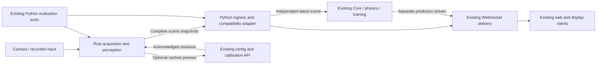

# Rust perception migration with maximum reuse — historical plan

> **Superseded migration scope:** this document records the earlier perception-
> first proposal and its implementation history. Do not follow its Rust/WASM
> browser-client or permanent-Python-gateway destination. ADR-0066 and the
> current [server migration plan](rust-domain-migration-plan.md) require the
> deployed server services to move to Rust while the browser remains
> HTML/JavaScript/CSS. Python model training, annotation, and acceptance tools
> may remain off-device. Ball-number classification remains excluded.

## Outcome and verification strategy

Replace acquisition and primary perception with a focused Rust engine while retaining the existing frontend, Python API, WebSocket delivery, physics, model assets, calibration workflows, and evaluation tools. The engine's first responsibility is fresh, accurate ball locations; number identification and predictions are independently scheduled consumers.

Implement in small, reversible changes. Verify shared contracts and model equivalence before moving the camera. Switch the default only after both macOS and Linux pass functional, accuracy, freshness, interference and sustained-operation gates. Do not port the existing architecture line by line or require rebuilding every Python component before starting Rust.

This is an implementation plan, not an implementation or a claim that Rust is faster. It builds on the [architectural review](architectural-review-2026-10-19.md) and [performance findings](performance-audits/findings.md), including the reproduced mismatch between the detector's MPS label and actual CPU execution.

## Confirmed deployment hardware and accelerator evaluation

**User-confirmed target (2026-10-21):** the production deployment target is an
HP EliteDesk 800 G4 Mini PC with an Intel Core i5-8600T (reported base frequency
2.30 GHz), 16 GB RAM, and Linux. A Coral USB Accelerator is available for
evaluation. The Linux distribution/version, attached webcam, negotiated camera
mode, and available USB link speed must be recorded during target-machine
qualification; they have not yet been established by this hardware declaration.

The Mac is a development and compatibility-test machine. Mac throughput and
latency results do not qualify performance on the EliteDesk. Preserve macOS and
Linux software support while making the EliteDesk the deployment-performance
acceptance target.

Next target-machine validation steps, in order:

1. Finish trustworthy stage timing and frame-to-state correlation, including
   disclosed audit losses and matched instrumentation-off/on checks.
2. Establish an ONNX CPU baseline on the EliteDesk with the real trained model,
   fixed recorded input and live webcam runs. Record actual execution provider,
   model/input hashes, camera mode, effective settings, latency, unique-observation
   throughput, CPU/memory use, and accuracy evidence. Use the Stage 8 repetition
   and sustained-operation requirements.
3. Evaluate Intel integrated-graphics acceleration only after verifying hardware,
   runtime/provider support, and actual operator placement on that Linux host.
4. Evaluate Coral as an optional inference backend using a versioned, fully
   integer-quantized TensorFlow Lite derivative compiled for Edge TPU. Preserve
   the original weights and ONNX baseline. Record compiler/runtime versions,
   representative quantization data, operations delegated to TPU versus CPU,
   and complete preprocessing, transfer, inference, and postprocessing costs.
5. Compare ball precision/recall, center and calibrated table-position errors,
   temporal continuity, freshness, and sustained throughput on identical inputs.
   Adopt Coral only if the complete state pipeline materially improves within
   the declared accuracy envelope; compilation or nominal accelerator throughput
   alone is insufficient evidence.

Coral acceleration is not yet selected, implemented, or qualified. A small
number-identification model operating on ball crops is a separate candidate
experiment under Stage 7 and must not delay primary localization. The current
trained detector's classes are `cue` and `ball`; numbered-ball identification
requires a separately trained and validated model, regardless of accelerator.

## Architecture decisions begin before code

The [architecture decision register](../docs/architecture/README.md) is the first
implementation artifact. Initial proposed ADRs 0009–0019 already document the
starting design; they do not claim that Rust implementation or qualification is
complete. Existing accepted ADRs 0001–0008 remain authoritative until explicitly
extended or superseded.

Each module task begins by reviewing its owning ADRs and resolving consequential
choices before dependent implementation. Prototype experiments may proceed under
a proposed record. When a choice is committed, mark the decision accepted and
track implementation/verification separately. Accepted does not mean implemented
or production-qualified.

Records include context and evidence, the decision and ownership, credible
alternatives, positive/negative consequences, failure and compatibility effects,
verification, dependencies and revisit triggers. Link implementing changes and
actual test/run evidence back to the records. Add a focused ADR whenever a new
consequential choice emerges, including concrete backend/camera selection or a
change to an accepted protocol or scheduling policy. Preserve history through
explicit supersession rather than rewriting earlier rationale.

| Migration stage | Governing proposed ADRs |
|---|---|
| 0: reference and reuse | 0009 boundary, 0017 acceptance tooling, 0018 qualification criteria |
| 1: interfaces | 0010 snapshots/time, 0011 local transport, 0014 revisioned control, 0034 raw versus emitted frame geometry |
| 2: model prototype | 0012 model exports and verified backend, 0017 external evaluation |
| 3: geometry/tracking | 0010 evidence, 0013 calibrated coordinates, 0016 localization priority |
| 4: gateway integration | 0009 ownership, 0010/0011 contracts, 0014 control, 0018 replay readiness |
| 5: live capture | 0014 applied revisions, 0015 camera/buffer ownership, 0016 preview isolation, 0018 live readiness, 0034 raw versus emitted frame geometry |
| 6: clients | 0010 evidence semantics, 0013 compatibility; retained ADRs 0003/0006 |
| 7: identity/secondary work | 0019 asynchronous identity, 0016 consumer budgets; retained ADR 0002 |
| 8: qualification/cutover | 0017 validation, 0018 rollout; retained ADR 0008 audit requirements |

Validate ADR structure, local references and register/status consistency before
closing each architecture change. No user confirmation is implied for every
record: make decisions within the authorized scope using evidence, and clearly
surface material changes in direction or tradeoffs.

## Retain, adapt, replace

| Existing investment | Treatment |
|---|---|
| `frontend/web/` React UI, routes, configuration/calibration screens and overlays | Retain. Fix shared connection/identity/freshness interpretation; add new information through an adapter. No framework rewrite or endpoint migration. |
| `frontend/projector/`, `frontend/visualizer/` | Retain where still required. Test coordinate, source identity, stale-expiry and prediction lifecycle fixtures; use compatibility payloads. |
| FastAPI, HTTP routes, WebSocket subscriptions and bounded client writers | Retain as the gateway and control plane. Remove direct dependencies on concrete detector/camera internals. |
| Python Core, game logic, physics and trajectory algorithms | Retain behind the compatibility adapter as optional scene consumers. Fresh locations must be publishable without their completion. |
| PT weights, existing CoreML packages and model training scripts | Preserve originals. Export versioned derivative artifacts from the same weights for Rust; no retraining required for localization migration. Validate existing packages against their own manifests rather than assuming equivalence to another PT file. |
| Existing recordings, still labels and calibration assets | Reuse with provenance. Validate coordinate frame, camera mode and calibration compatibility. Add missing temporal/physical annotations. |
| Python benchmarks, headless subscriber, report formats and annotation/scoring tools | Retain. Add selectable engine adapters and producer provenance instead of creating a competing scoring system. |
| Existing Python unit tests | Keep for retained code and Python reference behavior. Promote observable requirements to shared contract tests; write Rust unit tests for the new engine. |
| Python capture, shared-memory frame handoff, Vision orchestration and perception processing | Replace progressively with Rust acquisition/perception and owned in-process frames. Keep the selected Python provider for rollback during migration, subject to correctness qualifications. |
| Generic event/polling layers on the primary location path | Retire as Rust takes ownership. Preserve useful latest-work, revision, prediction lifecycle and slow-client contracts. |

The steady-state deployment can remain a Rust perception executable plus a small Python gateway/secondary engine. Replacing FastAPI or translating physics to Rust is not required to finish this migration.

## Target boundary



Start with one Rust executable and a small set of modules under a proposed `perception/` directory: input, frame ownership, inference, geometry, tracking, scene contract, transport, preview and diagnostics. Avoid a process or crate for each conceptual component. Dependencies are pinned after the inference prototype proves compatible.

Rust owns camera acquisition and all primary image-to-location work. Python initially owns configuration persistence, calibration authoring, the public API, and secondary physics. Each configuration/calibration change has an explicit accepted/applied revision; neither process silently owns a second mutable configuration database.

## Stage 0 — Protect reuse and establish comparison rules

**Modules/tasks, sequentially:** architecture records/documentation first, `backend/` reference/contract tests, then `tools/` export characterization.

- Preserve current uncommitted work. Inventory active endpoints, calibration operations, UI routes, model files and consumers before changing them.
- Pin/hash the actual audited model and reference inputs. Confirm the real execution device, preprocessing, tensor shape/type and model class map; a configured device label is insufficient.
- Capture the current public HTTP/WebSocket shapes as golden fixtures, including coordinate scale metadata, subscription acknowledgements, state, predictions, error handling and heartbeat behavior.
- Add requirement tests for stale cached observations, failure versus empty detections, source restart identity, calibration revision, unknown number, and track ID distinct from ball number. These define desired behavior; parity must not preserve known defects.
- Make only prerequisite Python repairs that affect retained components, trustworthy comparison, or qualified rollback. Do not rebuild the obsolete Python perception architecture merely to replace it later. Use decoded immutable fixture frames as the initial input oracle instead of relying on the existing shared-memory snapshot protocol.
- Collect a corrected Python reference on the same hardware and explicit backend, keeping the original run as historical evidence. Record known limitations rather than silently treating it as ground truth.
- Set versioned acceptance tolerances for positional accuracy, completeness, timing and numerical equivalence before viewing candidate results. Existing 50 ms and 2% audit figures are reference/configured budgets, not achieved performance. Physical tolerances require measured table data, not an invented pixel-to-millimeter conversion.
- Review and refine the initial proposed ADRs before their dependent implementation. Preserve prior records; accept or explicitly supersede decisions as the corresponding choice is committed, and link verification evidence as it becomes available.

**Done when:** a repeatable reference exists, preserved behavior is enumerated, intentional bug fixes are distinguished from compatibility obligations, and the first Rust slice has explicit tests/tolerances.

**Progress (2026-10-20):** the Python `.pt` reference path now passes its
configured device into Ultralytics inference and reports the predictor's
observed device separately. CPU and MPS each detected all five labels on one
existing 4K still; corresponding centers differed by at most 0.000061 pixels.
See the
[device-placement correction report](performance-audits/device-placement-20261020/report.md).
This is a placement and static-image check, not the corrected repeated
performance reference. Stage 0 remains open for matched PT/export prediction
equivalence, stale/failure/restart/calibration qualification, accuracy
tolerances, and the matched sustained audit.

**Progress (2026-10-20):** the integration boundary now deduplicates repeated
cached source observations before Core updates, receipt-freshness refreshes or
trajectory admission. Its unique-frame and duplicate-observation counters are
separate; source writer restarts with reset frame numbers remain distinguishable.
The decision and alternatives are recorded in
[ADR-0020](../docs/architecture/decisions/0020-deduplicate-polled-source-observations-before-state-updates.md).
Seven focused regression tests pass. The existing full-suite 80% coverage gate
remains a final completion requirement; this migration can continue through
replay prototypes while meaningful coverage is added to the touched paths. The
latest full backend run passed 1,160 tests and skipped one model-dependent replay;
coverage measured 47.39%. Full backend Ruff, Black, isort and mypy checks pass.

**Progress (2026-10-20):** the Python reference now retains each ball's last
wall-clock observation time across tracker misses and scheduler cache reuse,
serializes it per ball, and maps it to Core `BallState.last_update`. Tracker
expiry remains monotonic; frame timestamps continue to mean publication or
arrival, not camera exposure. The focused timestamp suite passed 41 tests. The
latest full run passed 1,162 tests and skipped one model-dependent replay;
coverage is 47.42% against the required 80% gate. Ruff, Black, isort, mypy,
ADR validation, and a read-only adversarial review passed. Stage 0 remains open.

**Progress (2026-10-20):** retained HTTP game-state and actual WebSocket wire
contracts are now pinned in versioned v1 fixtures. The state fixture is checked
through production replay and a real local socket; trajectory shape is checked
through the production broadcaster and a real socket; subscription
acknowledgement, protocol error correlation, and ping/pong are checked through
the production handler. The focused contract/replay selection passed six tests.
See [ADR-0017](../docs/architecture/decisions/0017-retain-python-tools-as-cross-runtime-acceptance-tests.md)
for fixture-to-test links. This establishes the main retained state/trajectory
wire shapes. Stage 0 remains open for other endpoint contracts,
failure-versus-empty qualification, restart and calibration qualification,
accuracy labels, PT/export prediction equivalence, and sustained-performance
requirements listed above.

**Progress (2026-10-20):** the existing YOLO exporter now requires an explicit
PT source, honors its output directory, protects prior artifacts from
accidental replacement, and emits a versioned hash/toolchain manifest. A
temporary ONNX export from the actual checkpoint passed graph validation and
loaded through ONNX Runtime CPU. Inspection showed the checkpoint and existing
CoreML package declare two generic classes (`cue`, `ball`), while repository
metadata claims either three or seventeen classes; the CoreML source lineage is
unavailable. Follow-up PT/ONNX inference on four stills produced matching class
IDs and counts for all 28 detections, with maximum center deviation 0.00025 px.
The export was removed after the probe. This is not physical accuracy or
performance evidence. See the
[model export characterization](performance-audits/model-export-characterization-20261020/report.md)
and [PT/ONNX comparison](performance-audits/pt-onnx-static-equivalence-20261020/report.md)
and [ADR-0012](../docs/architecture/decisions/0012-reuse-trained-models-through-verified-inference-exports.md).
Stage 0 remains open for repeatable tensor-level equivalence, consistent model
metadata, temporal/physical accuracy evidence, and the sustained audit.

**Progress (2026-10-20):** the retained equivalence workflow was restored as an
explicit PT-versus-candidate command, with a matching shell wrapper, stable
per-frame input names, model/package hashes, observed provider data, and
adjacent export-manifest evidence. The workflow was exercised with a fresh
temporary ONNX export of the actual checkpoint on all ten repository stills:
73 detections matched, with zero unmatched outputs, maximum center difference
0.000245 px, and maximum confidence difference 0.00000036. The actual provider
was ONNX Runtime `CPUExecutionProvider`; the full per-frame record and export
manifest are captured in the [JSON result](performance-audits/pt-onnx-static-equivalence-20261020/tool-run-corpus/equivalence-20261020T042945.248691Z.json)
and [summary](performance-audits/pt-onnx-static-equivalence-20261020/tool-run-corpus/equivalence-20261020T042945.248691Z.md).
This is static provider-equivalence evidence, not physical accuracy,
numbered-ball identity, or real-time performance. Golden tensor capture,
temporal/physical labels, and sustained performance qualification remain open.

**Earlier Python-reference progress (2026-10-20; superseded below):** the camera
reference previously preserved
the connection-probe frame as the first delivered frame, validates a positive
bounded capture queue, timestamps a frame immediately after software retrieval,
and measures backend-read duration with the monotonic clock. Tests exposed and
fixed stale camera status after a transient read failure, false `CONNECTED`
status at replay end, and source leakage when stopping after natural thread
termination. Thirty-two focused capture tests pass without camera hardware.
This strengthens the reference and rollback path; it does not move live capture
to Rust. Camera-focused tests cover 74.01% of `capture.py` statements, with
remaining gaps concentrated in backend-specific camera setup and reconnect
paths that need dedicated fakes.

**Progress (2026-10-20):** the reference capture path no longer uses a separate
startup probe read. Every frame read now runs on the single capture worker, so
startup cannot create a competing native reader and first-frame timing follows
the same measured path as later frames. Because Python cannot cancel a blocked
OpenCV/Kinect native read, `stop_timeout` now bounds only the caller's wait: a
timed-out stop retains the live source and rejects restart until the worker
returns; that worker releases the source exactly once before reporting
disconnected. Deterministic blocking-reader and Kinect callback/lifecycle
regressions verify no concurrent release, no stale post-stop frame, no
overlapping restart, and no callback-lock deadlock. The misleading camera
`read_timeout` configuration was removed. All 36 focused camera tests pass;
the full backend suite passes 1,439 tests with two model-dependent checks
skipped. Ruff, Black, isort, and mypy pass for the changed camera modules. This
repairs the Python reference lifecycle; it does not implement or qualify Rust
live capture. Physical camera behavior and macOS/Linux hardware qualification
remain open Stage 5 gates.

**Progress (2026-10-20):** detector-focused tests now exercise successful
Ultralytics box decoding and both common Edge TPU output-axis layouts. They
exposed and fixed a transposed-output decoding error and an NMS coordinate
contract error that could suppress distant balls. Detector elapsed-time
measurements now use a monotonic clock, with a deterministic wall-clock-jump
regression test. This is correctness and measurement hardening; it does not
establish live model accuracy or recommend a runtime migration.

**Verification checkpoint before failure-path repair (2026-10-20):** the complete backend suite reported 1,240
passed and one model-dependent replay skipped. Focused Ruff, Black, isort, mypy,
camera tests, and detector tests pass. The configured full-backend coverage run
measures 48.73% against the required 80% threshold and therefore still fails
its gate. Coverage is not waived or lowered; targeted tests continue to be
added before behavior changes to critical perception paths. Stage 0 remains
open.

**Progress (2026-10-20):** the retained detector-to-state path now preserves
failure semantics instead of treating detector errors as evidence that the
table is empty. The detector outcome API distinguishes detections, a successful
empty result, an unavailable model, and a failure with a bounded stage
category. Vision carries those outcomes forward and preserves the last valid
ball map and its observation times when detection is failed or unavailable;
Core retains its authoritative ball states in those cases, while a successful
observed-empty result still clears them. IntegrationService attaches the
current observation status to the corresponding emitted state event. This
closes the failure-versus-empty correctness gap in the retained Python
reference path; it does not complete the Rust migration or qualify production
accuracy/performance.

The event-status handoff currently relies on the sole in-repository Core state
update producer and synchronous event emission. If another producer or
asynchronous emission path is introduced, add an explicit correlation token to
the Core event contract so status cannot be associated with the wrong state.
The implementation and regressions are linked from
[ADR-0010](../docs/architecture/decisions/0010-immutable-source-timed-scene-snapshots.md).

**Latest verification (2026-10-20):** 90 focused cross-layer tests pass, along
with scoped Ruff, Black, isort, mypy, and diff checks. IntegrationService's
existing CRLF line endings were preserved and checked. The complete backend
suite reports 1,258 passed and one model-dependent replay skipped; coverage is
49.09% against the configured 80% threshold. The coverage gate remains open and
has not been lowered. Stage 0 and the overall migration remain incomplete.

## Stage 1 — Define the small interfaces and neutral fixtures

**Modules/tasks, sequentially:** `perception/` contract/schema/fixtures, then `backend/` provider adapter and contract tests. No live provider change.

Use three interfaces rather than reproducing all of `VisionModule`:

1. **Observation feed:** immutable complete scene snapshots with source evidence and health.
2. **Control:** start/stop capture, apply effective configuration/calibration, inspect actual device/model/camera settings, obtain readiness and acknowledge failures.
3. **Preview/reference access:** optional newest encoded preview plus occasional raw and rectified full-resolution calibration/reference stills, with source identity, sensor mode and rectification metadata, outside primary scene delivery. Unrectified calibration evidence must not be replaced by a reduced preview.

**Progress (2026-10-20):** the v1 scene-snapshot JSON Schema and neutral
success, failure, identity-update, and restart fixtures are committed under
[`perception/contracts/`](../perception/contracts/). The contract explicitly
separates run/session/frame/revision/transport identity, observation time from
publication time, image coordinates from calibrated millimeters, track IDs from
nullable ball numbers, and current measurements from estimates. Nineteen Python
schema tests and twelve Rust decode/validate/round-trip tests pass,
including failure-versus-empty, identity updates without freshening location,
independent cue status, calibration restrictions, restart identity, and exact
decimal-string nanosecond encoding. ADR-0010 is accepted for these semantics.
The first Rust crate slice provides typed, fail-closed encode/decode functions
with cross-field validation; all four Python fixtures round-trip through it.
The generic framing module also has nine tests for big-endian lengths, partial
I/O, truncation, consecutive frames, and rejection of oversized messages before
allocation. It does not yet create a socket or select an async runtime. Local
peer identity, queue/deadline behavior, slow readers, reconnects, and
Rust/Python clock comparability remain unimplemented; ADR-0011 stays proposed.

The scene contract includes:

- Schema version, engine/session ID, source frame ID, snapshot revision and transport sequence with distinct meanings.
- Original source observation/publication timestamps and clock semantics; sensor exposure time only when actually supplied. Each ball retains its own last observed time when other components update.
- Effective config, rectification, table calibration and map revisions.
- Success/failure/degraded outcome, visibility/coverage, and component freshness. Failure does not create a successful empty observation.
- Stable track ID; raw image center; separately tagged filtered/extrapolated estimates; calibrated table center when valid; explicit units/coordinate frames; positional uncertainty or an explicit unavailable value.
- Nullable ball number and separate identity evidence/confidence. Unknown stays unknown.
- Independent cue/phase evidence when available, without making cue presence a prerequisite for location delivery.

Use complete snapshots: the ball collection is small, and a receiver can recover immediately after skips/reconnection. Identity-only annotations may advance snapshot revision but preserve the underlying position observation ID/time. Published snapshots are never mutated.

Start internal transport with bounded loopback TCP and length-framed versioned JSON for small scene messages. Configure maximum message sizes, queue capacities, deadlines and reconnect policy. Keep control separate from the replaceable scene stream. Do not add authentication; keep the endpoint loopback-only, single-producer, schema-validated, and isolated from public control routes. ADR-0025 supersedes the original proposal to authenticate the launched local engine.

Each stream has a bounded newest-pending snapshot. A slow socket cannot block acquisition: disconnect or coalesce under configured policy, count skips, and reject stale/out-of-order data on ingress. TCP kernel buffers can also retain old data; application queue bounds alone do not establish freshness. Reconnection requests the latest complete snapshot rather than replaying stale history.

Do not send raw 4K images as JSON. Rust camera-to-inference frames remain owned inside the Rust process. Preview/reference image bytes use a separate bounded route.

Verify comparable monotonic clocks across Rust/Python before subtracting their timestamps. `std::time::Instant` is not a portable serialized cross-process epoch. Use an explicitly specified common clock with proof on each platform or report segmented durations; browser clocks remain separate.

**Done when:** Python and Rust validate the same golden messages, malformed/oversized data is rejected, restarts cannot collide with old identity, and time/coordinate/failure semantics are executable tests.

## Stage 2 — Prove existing-model inference in Rust

**Modules/tasks, sequentially:** `tools/` exporter, `perception/` inference/replay, `backend/` benchmark adapter.

- Extend `tools/export_high_res_model.py` instead of introducing a second exporter. Accept an explicit source model; do not select a model merely because its filename sorts last.
- Preserve PT weights as the training/reference source. Export ONNX derivatives first for a portable inference candidate; retain existing CoreML artifacts and evaluate them when their source lineage is known.
- Produce a model manifest: source/export hashes, classes, exporter/runtime versions, layout/dtype/shape, RGB/BGR handling, normalization, resize/letterbox mapping, output layout, NMS location and thresholds, supported provider profiles and precision.
- Use the existing model resolution/semantics first. Changing language, model, resolution, tracker and scheduler together would make discrepancies untraceable.
- Prove Python PT against Python exported inference, then the identical export through Rust. Compare exact decoded image fixtures, preprocessing tensors, outputs and detections within declared tolerances. A PT minimal-rectangle input and fixed-square export must be compared under deliberately equivalent preprocessing.
- Start with an inference adapter using ONNX Runtime through Rust bindings and supported provider settings. Qualify macOS CoreML and Linux CPU; qualify Linux accelerator support separately on available hardware. If a provider cannot execute the model acceptably, evaluate an alternative adapter behind the same interface before committing the engine to it.
- Record actual provider/device/partition evidence and fallback. Provider availability is not proof that the graph is accelerated.
- Build the first executable slice: recorded frames → same model → measured image locations → complete per-frame detection batch → Python/headless receiver. Stage 2 has no tracker and must not invent stable track IDs; tracked scene-snapshot v1 remains the Stage 3 output after real association exists. No trajectory, preview, identity classifier or motion-dependent localization skipping is required for this first gate.

**Progress (2026-10-20):** an immutable `detection-batch v1` contract now
represents complete detections from exactly one source frame, including model
hashes/class map, decoding settings, source-image geometry, timing semantics,
batch-scoped detection indices, and success/empty/failure distinctions. This
keeps `scene-snapshot v1` unchanged until tracking supplies stable IDs. Four
shared fixtures pass Rust decode/validation/round-trip and Python JSON Schema
validation; 10 Rust contract tests and 11 focused Python tests pass. See
[ADR-0021](../docs/architecture/decisions/0021-frame-scoped-detection-batches-before-tracked-scene-snapshots.md)
and the [contract notes](../perception/contracts/detection-batch/v1/README.md).
The inference executable now emits these batches to an optional JSONL artifact;
Python/headless receipt, paced freshness, Linux qualification, and restart
behavior remain open.

**Progress (2026-10-20):** the real two-class checkpoint has now been exported
to a temporary, hash-verified ONNX artifact and executed by the Rust
`billiards-perception-infer` binary over the ten-image 4K fixture set. The Rust
loader checks both the ONNX digest and the explicitly supplied source
checkpoint digest against the exporter manifest. The fixed-square 1280 input
matches the Python equivalence harness: preprocessing tensors were bit-exact
on all nine PNGs, and Rust CPU/auto outputs paired all 73 Python PT detections
within 2 px. Adversarial decoder tests now verify Ultralytics' strict
confidence-threshold and pre-clipping NMS behavior; the post-fix ten-image CPU
replay kept all detections and centers unchanged. A separate provider trace
showed the Mac auto policy actually partitioning nodes between CoreML and CPU.
The repeatable 30-sample results,
annotation scoring, hashes and limitations are recorded in the [prototype
report](performance-audits/rust-inference-prototype-20261020/report.md).
Rust format, 35 unit/contract tests and strict Clippy pass.

This is an inference prototype, not completion of Stage 2. The existing Python
production path leaves `imgsz` to Ultralytics defaults, so the fixed-1280
comparison is not production preprocessing parity. The 2 px still-label score
is poor (18/52 centers matched within tolerance), and the corpus has no temporal
or physical-coordinate ground truth. The Rust prototype does not yet forward
the complete detection batch through a Python/headless receiver, measure paced
freshness, qualify Linux, or exercise camera/model restarts. Keep ADR-0012 proposed and
do not recommend a production provider from these data. The full backend
coverage gate remains 49.09% against 80%; this prototype does not close it.

**Progress (2026-10-20):** the retained Python comparison tool now consumes the
saved Rust CPU replay through a validated result adapter. It checked the
checkpoint hash, class map, fixed-square image size, confidence/IoU thresholds,
detection cap, complete one-to-one source mapping and all ten encoded-image
hashes. All 73 outputs matched the Python PT reference with no unmatched
detections; maximum center difference was 0.0325 px. The JSON and Markdown
summary are preserved in the [tool-run evidence](performance-audits/rust-inference-prototype-20261020/tool-run/equivalence-20261020T123923.419656Z.json)
and its [readable report](performance-audits/rust-inference-prototype-20261020/tool-run/equivalence-20261020T123923.419656Z.md).
The adapter handles saved unpaced still-image results only; it is not the live
producer, headless receiver or timing harness. This closes the narrow
cross-runtime scoring step for a static prototype, but Stage 2 remains open for
live-equivalent preprocessing, representative accuracy, freshness, restarts and
Linux qualification. Focused adapter tests, Ruff, Black and mypy pass. The
existing aggregate coverage gate is unchanged at 49.09% versus 80%.

**Progress (2026-10-20):** a raw-RGB diagnostic isolated the known JPEG tensor
mismatch to file decoding, before resize: on the corpus's single JPEG, 695,791
of 8,294,400 decoded pixels differed in at least one channel between Rust
`image-rs` and Python OpenCV, with mean absolute channel difference 0.06365/255
and maximum 3/255. The [diagnostic evidence](performance-audits/rust-inference-prototype-20261020/evidence/raw-jpeg-decoder-comparison.json)
and reproducible [Rust probe](../perception/examples/decode_rgb_probe.rs) are
preserved. This narrows the parity issue but does not prove a detection impact
or justify a decoder dependency; multiple JPEGs and Linux remain to be tested.

**Progress (2026-10-20):** the recorded-image executable now has an opt-in
`detection-batch v1` JSONL output path requiring explicit engine-instance and
source-session IDs. A ten-image real-model smoke produced 10 ordered records
covering 73 detections. Python's shared JSON Schema validator accepted all
records, every still-image source timestamp remained null, and the aggregate
report's batch count matched. The retained equivalence tool now validates and
joins the JSONL against its aggregate report; all 73 detections paired with
the Python PT reference, no outputs were unmatched, and maximum center delta
was 0.0325 px. The smoke caught and fixed a numeric contract mismatch: emitted
centers are now derived from the serialized boxes in `f64`, so center-to-box
validation remains strict at 4K coordinates. The
[JSONL artifact](performance-audits/detection-batch-jsonl-smoke-20261020-fixed/detection-batches.jsonl),
[aggregate report](performance-audits/detection-batch-jsonl-smoke-20261020-fixed/audit-report.json),
the [equivalence result](performance-audits/detection-batch-jsonl-smoke-20261020-fixed/equivalence-final/equivalence-20261020T133321.599979Z.json),
and [smoke notes](performance-audits/detection-batch-jsonl-smoke-20261020-fixed/report.md)
are retained. This is synchronous, unpaced file output from a development
build; its ten-sample timings are not a performance baseline. Python/headless
receipt timing, socket transport, paced freshness, live capture, Linux
qualification, restart handling, and temporal accuracy remain open. The full
backend coverage gate remains 49.09% against 80%.

**Progress (2026-10-20):** the checked-in production CoreML package was loaded
and run through the retained Python detector in an isolated macOS arm64
environment with CoreML Tools 9.0. The resolved input was `[1, 3, 1280, 1280]`
float32 in `[0, 1]`; predictor settings were `rect=true`, batch 1, max 300,
confidence 0.40 and IoU 0.45. The model returned all five labeled balls on
`multiple_balls.png`; mean center error was 2.91 px and maximum was 5.33 px,
with only two of five centers within 2 px. This is a one-image detector smoke,
not a camera-to-client latency or physical-accuracy result. The package has
only generic `cue` and `ball` classes, so it cannot identify numbered balls.
CoreML reported a `CPU_AND_NE` compute-unit policy; actual per-operator device
utilization remains unavailable. Auto device selection now recognizes a native
`.mlpackage` on macOS as CoreML, and model information reports backend family
separately from physical compute device. CoreML Tools is an explicit macOS-only
backend requirement. See the [captured result](performance-audits/coreml-production-smoke-20261020/result.json)
and [readable report](performance-audits/coreml-production-smoke-20261020/report.md).
For this same PNG, the Python CoreML and Rust CPU preprocessors produced exactly
equal float tensors. The five output detections paired within 2 px, with maximum
center difference 1.15 px and confidence difference 0.02354. Because the
CoreML package lacks verified source lineage, this does not establish weight or
runtime equivalence; the saved [tensor](performance-audits/coreml-production-smoke-20261020/tensor-comparison.json)
and [output](performance-audits/coreml-production-smoke-20261020/coreml-vs-rust-static-comparison.json)
comparisons are one-image evidence only.

**Progress (2026-10-20):** the static Rust replay now has a synchronous,
length-framed loopback TCP output and a Python headless receiver. The receiver
validates each batch against the shared schema, records local monotonic receipt
times, completeness, order, gaps, duplicates and bounded detail records, and
writes the received payloads to JSONL for the existing scorer. On the real
checkpoint and ten repository stills, it received all 10 batches in order,
covering 73 detections. The existing Python PT comparison matched all 73 with
zero unmatched outputs and 0.0325 px maximum center difference. This run's
receiver inter-arrival p50/p95/p99 was 92.128/94.518/94.518 ms; the Rust
synchronous batch construction/serialization/socket writes took 0.477 ms total.
These are unpaced replay diagnostics, not camera freshness or one-way latency:
the Rust/Python monotonic clock epochs are unverified. Evidence is in the
[loopback replay report](performance-audits/detection-batch-tcp-smoke-20261020-r2/report.md),
[Rust report](performance-audits/detection-batch-tcp-smoke-20261020-r2/rust-replay-report.json),
[receiver report](performance-audits/detection-batch-tcp-smoke-20261020-r2/receiver-report.json),
and [received-batch equivalence result](performance-audits/detection-batch-tcp-smoke-20261020-r2/equivalence/equivalence-20261020T150209.339109Z.md).
The prototype accepts a single unauthenticated loopback connection and can
block the replay sender; ADR-0011 remains proposed. Paced capture, bounded
asynchronous delivery, slow-reader isolation, reconnects, clock comparability,
Linux qualification, temporal/physical accuracy and camera ownership remain
open.

**Verification checkpoint (2026-10-20):** the full backend suite now reports
1,310 passed and one model-dependent replay skipped. No test failed, but the
command exits at the configured coverage gate: 60.67% measured against the
required 80%. The threshold has not been lowered; this is not a completion or
rollout gate pass. Migration work can continue in reversible replay slices
while coverage is raised on the critical paths being changed, and the 80% gate
must pass before the backend is declared complete. The run also exposed a
missing-config failure in shot suggestions: the assistance engine now merges
canonical schema defaults with partial user overrides, and the full suite
passes that behavior.

**Progress (2026-10-20):** Stage 2 now has an opt-in paced recorded-image
replay path. A producer presents decoded files on the requested monotonic
schedule through a capacity-one latest-frame mailbox; a newer decoded frame
replaces a stale pending frame while inference runs. Batches preserve source
frame identity independently from contiguous publication sequence and carry a
synthetic `frame_arrival` timestamp created after file decode. Reports include
source-read deadline misses, replaced frames, observed source/processed rates,
and source-to-inference-start/completion percentiles. This timestamp is not
camera exposure time.

The CPU smoke requested 30 fps over ten repository stills. The file producer
decoded ten but was late against all ten synthetic deadlines, averaging
24.51-fps availability; inference processed eight and replaced two pending
frames. Source-arrival-to-inference-complete p50/p95/p99 was 71.71/94.08/94.08
ms on eight samples. The existing Python PT scorer accepted the partial run by
source index and encoded-file hash, joined the emitted batches, and matched all
46 detections for the eight processed images with zero unmatched and 0.000245
px maximum center error. Because file decoding itself averaged 44.08 ms and the
CPU model call averaged 46.08 ms, this smoke does not estimate camera-paced
capacity or justify a provider change. It also does not prove the common model
predictions physically accurate. See the [paced replay report](performance-audits/paced-latest-frame-smoke-20261020-r2/report.md),
[run metadata and ten input hashes](performance-audits/paced-latest-frame-smoke-20261020-r2/run-metadata.json),
[Rust batches](performance-audits/paced-latest-frame-smoke-20261020-r2/detection-batches.jsonl),
and [scored result](performance-audits/paced-latest-frame-smoke-20261020-r2/equivalence/equivalence-20261020T151758.327711Z.md).

The first implementation note overstated the configured Python detector's
unknown inference size. The checked-in CoreML package declares
`imgsz: [1280, 1280]`, and the retained Ultralytics 8.4.182 predictor uses that
exported size; the 1280-square input therefore matches its declared dimensions.
CoreML package lineage and CoreML-versus-ONNX parity remain open, so the
correction does not close production preprocessing parity.

This is replay-only evidence: no camera, TCP receiver, one-way receipt latency,
120-second repetitions, 20-minute soak, Linux qualification, or temporal and
physical accuracy data were exercised. The backend coverage gate remains
60.67% versus 80% in the latest full-suite run; the threshold remains intact
and no completion claim is made.

**Progress (2026-10-20):** the Rust executable also built and ran the same
hash-verified ONNX model on Debian 13 ARM64 under the available Linux
container engine, using Rust 1.92 and ONNX Runtime CPU. It processed the same
ten still images and emitted ten complete batches covering 73 detections. The
retained Python scorer matched all 73 outputs, with zero unmatched and a
0.0325 px maximum center difference. Mean per-image pipeline time was
136.46 ms in this virtualized, unpaced smoke; it is not comparable to the Mac
timing and does not qualify physical Linux hardware or a live source. The
scorer now uses source-frame index to disambiguate duplicate image content
only after validating its encoded-image hash and any resolvable path. See the
[Linux smoke report](performance-audits/linux-perception-smoke-20261020/report.md),
[run metadata](performance-audits/linux-perception-smoke-20261020/run-metadata.json),
[Rust report](performance-audits/linux-perception-smoke-20261020/rust-replay-report.json),
and [cross-runtime comparison](performance-audits/linux-perception-smoke-20261020/equivalence/equivalence-20261020T152704.641143Z.md).

This narrows Stage 2's open platform evidence to physical Linux qualification,
including target deployment packaging and hardware. Accuracy, camera freshness,
TCP receipt timing, repeated long runs, CoreML lineage, and the backend coverage
gate remain open.

**Verification checkpoint (2026-10-20):** the latest complete backend test run
collected 1,309 tests: 1,308 passed and one model-dependent replay was skipped.
There were no test failures, but the configured coverage check still failed at
49.25% against the unchanged 80% threshold. This newer run supersedes the
previous 60.67% measurement as the current gate result; the reason for the
measurement change has not been isolated. Do not lower the threshold or treat
the passing test count as a coverage-gate pass. The focused scorer tests,
Ruff, Black, and mypy pass independently.

**Progress (2026-10-20):** `FrameInferenceEngine` now accepts an immutable
in-memory RGB frame and returns complete detections with separate
preprocessing, inference, and decode/NMS durations. The recorded replay uses
the same engine path, so the file harness and future frame sources will share
model signature validation, preprocessing, ONNX execution, and detection
decoding. A deterministic ONNX fixture test covers the full API path. A
temporary export from the actual checkpoint was run over the ten still images
and scored by the retained Python PT evaluator: 73 detections matched, zero
unmatched, maximum center difference 0.032512 px. Mean inference was 41.014 ms
on ten unpaced CPU samples; this is integration evidence, not a performance
baseline or real-time freshness measurement. See the
[frame-engine smoke report](performance-audits/frame-engine-api-smoke-20261020/report.md)
and [run metadata](performance-audits/frame-engine-api-smoke-20261020/run-metadata.json).
The full backend suite's latest recorded coverage remains 50.18% against 80%;
it is neither waived nor a blocker to these isolated Rust replay steps. A
production camera library remains unselected pending the two-platform hardware
spike in [the camera-adapter note](rust-camera-adapter-spike.md).

**Measurement correction (2026-10-20):** review found the first smoke's
`measurement_session_init_ms` included repeated manifest and model/checkpoint
hashing, unlike the provider-probe metric. The audit now reuses the verified
model contract and measures only session creation plus signature validation.
The repeated run measured 11.591 ms versus 16.549 ms for the provider probe;
all 73 Python PT detections matched with no unmatched outputs and 0.032512 px
maximum center difference. The initial session-init value is superseded; its
per-image measurements remain usable. See the
[correction note](performance-audits/frame-engine-api-smoke-20261020/measurement-correction.md)
and [corrected run](performance-audits/frame-engine-api-smoke-20261020-r2/report.md).

**Progress (2026-10-20):** the retained equivalence tool now optionally scores
CVAT image-box annotations alongside Python/Rust equivalence. On the nine
annotated 3840×2160 stills, Rust and Python produced the same 57 detections;
maximum cross-runtime center difference was 0.000256 px. At a 20 px image-space
association radius, the model matched 52/52 labeled balls, with three extra
ball detections and mean/p95/max matched center error of 3.81/9.23/14.99 px.
At 10 px, ball results were 49 true positives, 6 false positives and 3 false
negatives. Cue localization matched 0/3 labels within 20 px. The model only
exposes generic `ball` and `cue` classes. One unpaced CPU run measured 97.56 ms
mean decode-to-detection per still, including about 43.02 ms file decode and
44.80 ms inference; this is not camera freshness or a live frame-rate result.
No production threshold was chosen from these labels, and pixel error cannot
be converted to table-space error without a verified calibration. See the
[audit report](performance-audits/rust-cvat-ground-truth-20261020/report.md),
[20 px score](performance-audits/rust-cvat-ground-truth-20261020/scored/equivalence-20261020T192553.172605Z.md),
and [10 px sensitivity score](performance-audits/rust-cvat-ground-truth-20261020/scored-radius-10/equivalence-20261020T192733.614563Z.md).
The scorer's 66 focused tests, Ruff, Black and mypy pass. Static model
evidence advances Stage 2, but physical accuracy, temporal annotations,
numbered-ball identity, live-camera measurements, Linux hardware qualification
and the backend coverage gate remain open. The 64 scorer tests and three
local-access/no-auth tests pass. The complete backend suite now reports 1,428
passed and two model-dependent tests skipped; coverage remains 51.36% against
the unchanged 80% gate, which is the sole reason that command exits nonzero.
The API and local stream remain anonymous; this work adds no authentication.

**Done when:** the real model executes on both platforms, declared backend selection matches execution, exported detections pass accuracy/equivalence checks, and existing Python tooling can score Rust results. No retraining is required to pass this localization gate.

## Stage 3 — Implement precise geometry and tracking in Rust

**Module:** `perception/`, with Python evaluators used unchanged or through the Stage 2 adapter.

- Implement explicit raw/rectified/cropped/resized-to-source transforms, tested against existing calibration fixtures and reference math.
- Reuse calibration assets and Python calibration solvers initially; Rust applies a validated immutable bundle. Reject incompatible sensor modes or mark physical coordinates unavailable rather than silently using the wrong transform.
- Add table-space locations while retaining image measurements. Begin with existing box-center measurements for traceability, then evaluate geometric/learned-center refinement as a separate change. Physical held-out measurements are the precision gate.
- Implement tracking against source observation time with explicit measured, tentative, filtered, lost and estimated statuses. Port useful association behavior and tests; do not carry over arbitrary frame-count/timing assumptions without justification.
- Preserve visible positions while identity remains uncertain. Periodically reconcile the complete scene and recover from ROI misses, manual relocation and occlusion.
- Establish continuous localization during dense motion. Treat the existing phase scheduler as reference/test material; its MANY_MOVING suppression is not the new policy.

**Progress (2026-10-20):** ADR-0013 now commits to the center-origin
millimeter frame and exact camera/profile/resolution/rectification matching.
`backend/vision/calibration/perception_export.py` exports the retained Python
meter homography into that immutable bundle and requires the provenance that
the legacy calibration cache does not store. Rust validates the bundle and
projects source-image points without clamping. A Python-generated perspective
fixture passes through the Python exporter and Rust projector, mapping all four
declared table corners to their expected millimeter coordinates. Schema,
exporter and projection checks pass (20 focused Python tests and 85 Rust
tests); the full backend suite passes 1,334 tests with one model-dependent
replay skipped. The configured coverage gate remains open at 49.62% versus
80%; the gate has not been lowered.

The Rust geometry adapter can now transform a complete successful detection
batch all-or-nothing, retain source measurements and frame identity, reject
failed inference, and require valid applied calibration context even for an
empty observation. It still does not invent stable track IDs. The audit/runtime
now has an opt-in calibrated replay mode. It requires a calibration bundle,
explicit applied profile/revisions and source image space, and retained raw
detection-batch output. Each report frame contains calibrated measurements or
an explicit unavailable reason; calibration time is measured separately. The
bundle loader validates and hashes the same bytes used to construct the
immutable calibration options, preventing report provenance from drifting from
the applied geometry. The batch schema remains unchanged. The live producer
still does not call this adapter, and the batch itself lacks the camera profile
and actually applied calibration/rectification revisions needed to construct a
trustworthy context. Source crop/resize transforms, calibrated scene production,
temporal annotations, and held-out physical
ball-center accuracy remain open. The table uncertainty stays unavailable,
and these tests do not establish physical precision. The current repository
contains camera intrinsics at `backend/calibration_cache/camera_params.json`
(3840×2160) but no saved table-plane transform, camera-profile identity, or
applied calibration/rectification revisions. Consequently there is no
deployment calibration asset to run through the new adapter or evidence from
which to claim table-space accuracy. Stage 3 needs a source-identified table
calibration and held-out physical ball placements before such a result can be
qualified.

The experimental `SceneTrackerV1` accepts successful source-timed detection
batches and emits validated scene-snapshot v1 output. It publishes the detector
center immediately, uses one-to-one gated association for track continuity, and
keeps bounded motion extrapolation private to association. It preserves the
last actual measurement/time through occlusion and loss, expires by source time,
resets association on session/model/profile/geometry/clock changes, and keeps
cue absence separate from ball tracks. The recorded-image replay can now opt in
to scene JSONL with explicit tracking settings and reuses the frame's already
computed calibration result. A configured calibration mismatch degrades the
scene and clears physical positions while preserving image observations. Scene
publication time is captured after tracking immediately before serialization.
This path is paced replay only; it is not wired into live camera capture, a
bounded scene transport or the Python gateway. Temporal annotations and
model-backed replay evidence remain necessary before accepting ADR-0022 or
recommending this policy for production.

An adversarial review found that the public precomputed-calibration entry point
could pair a valid transform from one frame with another frame's detections.
The calibrated result now retains its acknowledged camera profile, and the
tracker verifies engine, batch, full source identity (including dimensions and
timestamp), image space, camera/calibration/rectification revisions, and every
detection's ordered identity and measured center before accepting physical
coordinates. A mismatch fails closed without consuming the observation or
advancing track IDs; the regression test covers stale frames, altered centers,
and profile/revision/image-space mismatches. This closes a correctness defect
in replay pairing but is not evidence of real-world calibration accuracy.

Rust deterministic tests now cover calibrated positions, calibration mismatch,
precomputed-transform provenance pairing, and stale physical-position clearing
in addition to source-time association.
The scene-output CLI requires complete explicit configuration and paced input.
The model-backed paced smoke processed 9/10 mixed still images, with one pending
image replaced. All nine scene records correlated with their raw batches and
passed the shared Python schemas. Python matched all 57 Rust detections with no
unmatched results and 0.03252 px maximum center difference. Mean scene tracking
and JSONL export were 0.0730 ms and 0.0614 ms, while mean detector pipeline time
was 92.70 ms. All ten synthetic 30 fps deadlines were missed; the 17.58 fps
processed rate is not real-camera evidence. A 24-track configuration failed
closed, then the smoke completed with an explicitly bounded capacity of 300 on
this non-temporal still-image corpus. Physical table coordinates remain
unavailable because this run did not use a table calibration asset.

The most recent full backend run passed 1,329 tests with one model-dependent
replay skipped but exited on the configured coverage gate: 49.44% versus 80%.
Ruff, Black, isort, and mypy pass after the import-order fixes. This shortfall is
an outstanding repository acceptance check, not a dependency of isolated Rust
prototype work; migration verification cannot be called complete until it is
addressed. The Rust-emitted scene fixture also passes the focused Python
scene-contract module with coverage collection disabled.

**Follow-up verification (2026-10-20):** after the camera lifecycle and
precomputed-calibration pairing fixes, the complete Rust crate passes format
checking, strict Clippy, and 105 Rust tests. The full backend suite passes
1,440 tests with two model-dependent replay checks skipped by default. This
backend run disabled coverage collection, so the previously measured shortfall
against the required 80% gate remains open. No application or internal-stream
authentication was added; the anonymous-access contract tests are included in
the passing backend suite.

**Bounded stream follow-up (2026-10-20):** adversarial transport review found
that oversized submissions could retry forever, repeated partial socket
progress could stretch an operation beyond its timeout, and a slow handshake
could write a stale scene ahead of the latest one. Rust scene transport now
rejects and counts over-limit submissions before queueing, uses an absolute
monotonic deadline for each complete handshake and frame write, rejects unsafe
receiver watermarks, and replaces a not-yet-written scene with the newest
pending one after connection setup. The focused transport tests pass and strict
Clippy remains clean. Protocol v2 scopes reconnect watermarks to the
engine-instance and source-session provenance already carried by each scene.
On a producer epoch change, the receiver resets ordering/freshness state and
discards/counts stale queued data; the sender reconnects on identity changes.
Same-epoch reconnect deduplication and restart-at-sequence-one are covered by
Rust and Python tests. This closes the previously open restart-watermark issue.
No authentication or credential was introduced.

**Done when:** labeled still and temporal accuracy pass; no duplicate aging or invented observations occur; physical position error is measured across the table; tracking gaps, first-detection delay and collision behavior meet declared acceptance criteria.

## Stage 4 — Connect Rust observations to the retained Python gateway

**Module:** `backend/` provider lifecycle, ingress, compatibility adapter, API routes and integration tests.

- Introduce an explicit `python`/`rust` perception provider setting with validated defaults. Keep the existing provider selected until qualification; avoid silent automatic switching that can change semantics or reopen the camera unexpectedly.
- In Rust mode, disable Python acquisition/inference startup. Supervise the Rust process, readiness, errors, shutdown and restart with a new source session on restart.
- Publish validated fresh scene locations before waiting for Core/physics. Feed existing Core and prediction code independently through a bounded latest-scene consumer.
- Give each public stream exactly one publisher. In Rust mode the ingress owns location-state publication; Core's later `state_updated` events must not publish a second conflicting state stream. Predictions remain a separate stream tied to the originating scene. Existing game metadata can be read from current retained context without waiting for a new physics calculation.
- Preserve current frontend URLs, subscriptions and state/prediction payloads. Map source image geometry once into existing canonical-4K fields with explicit scales. Add physical coordinates and provenance as separately typed additive data; never put meters into old pixel fields.
- Keep observation identity/time intact through mapping. Publish degraded/expired health without refreshing the last actual observation. Distinguish engine heartbeat from a new scene.
- Keep existing prediction computation and lifecycle. Adapt scene/cue inputs to the existing Python shapes, with stale/revision checks. Predictions carry their parent observation and never block locations. If cue support is not yet ready, report predictions unavailable explicitly until the corresponding gate passes.
- Add real workload switches for predictions, identity and preview, separate from audit-domain switches.
- Replace routes' direct detector/camera access with control/preview interfaces. Preserve HTTP behavior while making negotiated settings, actual backend and applied revisions inspectable.

**Historical progress (2026-10-20, before ADR-0025):** an early, superseded
scene-snapshot v1 prototype briefly included credential-based admission in its
`SceneSnapshotIngress`. That prototype and its credential check were removed;
the current application and internal scene stream have no authentication or
authorization feature, and none is permitted by ADR-0025/0028. The v1 ingress
also bound to loopback, enforced configured frame bounds and schema
validation, pinned producer and source-session identity, rejected
duplicate/out-of-order snapshots and stale repeated observation times, and
kept a single newest pending complete snapshot. Its historical 18 focused
tests covered socket receipt, the now-removed credential check, coalescing
under a slow consumer, sequence gaps, stale data, malformed frames, idle
timeouts, reconnect watermarks, and configuration validation.
The Rust replay sender now serializes into a bounded latest-only slot serviced
by a background writer. Socket connect/write deadlines and capped exponential
reconnect delays are configurable. The receiver's `ready` response carries its
last accepted transport sequence; after reconnect, the sender sends the newest
sequence only when it exceeds that watermark. Rust tests cover queue
replacement, delayed handshake, a non-reading peer, reconnect and shutdown.

The actual CPU ONNX cross-runtime smoke queued and locally wrote all 10 scene
snapshots; the Python ingress schema-accepted all 10. Its one-slot pending
queue replaced 9 records because no consumer drained it, with zero sequence
gaps or rejected messages. Sender local writes and
receiver acceptances are reported separately because TCP write completion is
not an application acknowledgement. The run processed 2.29 fps, missed all
ten synthetic 30 fps deadlines, and measured mean decode/preprocessing at
364/358 ms versus 40.8 ms inference. Scene encode/enqueue was about 0.45 ms.
This small run points to image decode and preprocessing as candidate hotspots,
but does not establish an optimization recommendation or a controlled
transport delta. One-way latency remains unavailable. Details are in [the
bounded asynchronous cross-runtime smoke](performance-audits/scene-async-tcp-replay-20261020T164934Z-df11e6/report.md);
the earlier synchronous run is retained as [historical evidence](performance-audits/scene-tcp-replay-20261020T163659Z-853bb3/report.md).

ADR-0025 rejects the credential check described in this historical progress
snapshot. The protocol now uses an anonymous version-2 hello with
engine/source-session provenance so receiver watermarks are scoped to a
producer epoch; the performance measurements remain useful for latency and
throughput, but rerun them if comparing handshake effects.

Stage 4 remains open: `perception.provider` validates `python`/`rust`, defaults
to Python, and requires restart. FastAPI supports Rust only with
`perception.mode=recorded_replay`: it starts the supervised Rust executable,
withholds startup readiness until the first usable localization, and publishes
scenes to the HTTP state read model and WebSocket stream without starting the
Python Vision/IntegrationService path. Rust plus live mode is rejected before
startup and never falls back silently. Scene-to-Core physics adaptation,
live-camera ownership, preview, and predictions remain unavailable. The
recorded replay still writes the detection-batch artifact synchronously, so its
timings do not represent the eventual camera path. Focused provider,
adapter/worker, replay, and lifecycle checks pass; the full backend suite remains
below its coverage gate. Cargo format, strict Clippy, and Rust tests pass for
the current transport slice.

**Progress (2026-10-20):** ADR-0023 adds a single scene read model for the HTTP
state bootstrap and WebSocket publisher. `GET /api/v1/game/state` now prefers
the publisher's defensive scene snapshot when one is explicitly attached,
serves scene localization without requiring Core, and includes Core table
geometry only when scene and table calibration revisions match. Missing or
mismatched metadata is explicit; current Core tables have no revision
provenance, so the scene response withholds their geometry. Unknown velocity,
cue-ball role and pocket status remain nullable. Scene pixels, calibrated
millimeters, source frame identity/time, gateway publication time, and paired
UTC/monotonic ingress receipt times remain distinct. Per-ball UTC receipt
advances only when that ball's source-observation identity changes, so newer
scene estimates, health, and source silence do not freshen a cached location.
Successful empty observations are valid; scenes with no usable positions are
invalid. The Python-only HTTP golden response remains unchanged, and the
frontend has an explicit scene/Core response union plus a typed state request.
The focused backend tests pass (45 tests); the frontend contract test passes
with its API base URL configured. The full frontend typecheck remains blocked
by existing errors across unrelated files; no errors were reported in the
changed frontend files. This does not activate or supervise Rust, and Stage 4
remains open.

**Progress (2026-10-20):** a tested scene-to-existing-state compatibility
adapter and a bounded ingress consumer now form a backend vertical slice. The
adapter maps only raw-image measurements into canonical 4K pixels, preserves
millimeter coordinates separately, keeps track IDs distinct from numbered-ball
identity, and carries source timestamp ticks, clock domain, revisions, and
measured-versus-estimated status. A rectified point is rejected because the
current preview has no declared rectification transform. The legacy renderer
radius remains an explicit standard-ball assumption; it is not a Rust detector
measurement. The consumer publishes directly through the existing state
broadcaster, ignores identity annotations as new locations, reports explicit
health failures and configured source silence as stale state without advancing
ball observation times, and drains the ingress' capacity-one newest slot while
a downstream send is slow. Silence is timed from the last successful
localization's monotonic ingress receipt; annotation and health records do not
extend that freshness deadline. Cached balls report current position confidence
as unavailable and retain detector confidence only as historical evidence.
All seven frontend test files pass 39 tests. The
frontend preserves unknown identity, resets measured trails on engine/session
restarts, rejects rectified Rust points, labels stale measured balls as last
observed, and shows unavailable position confidence as `n/a`. After the
source-silence and historical-confidence regressions, focused adapter, worker,
and pipeline-replay tests pass 24 cases, with one model-dependent replay
skipped. The real-WebSocket regression verifies that stale state reaches a
subscriber with unavailable current-position confidence and preserved
historical detector confidence. The repository-wide web TypeScript check still
reports existing unrelated errors, with no diagnostics in the changed API,
VideoStore, or overlay files. At this checkpoint, the provider setting and
fail-closed startup preflight were integrated, but FastAPI did not yet start
the Rust ingress, state worker, or supervised process. Later progress below
records that replay-lifecycle integration; Core/prediction adaptation remains
separate work. Stage 4 is still open.

The complete hardware-free backend suite passed 1,376 tests with one
model-dependent replay skipped. Coverage is 50.18%, so the run still exits on
the unchanged 80% gate. The gate is not waived; isolated migration work can
continue, and completion still requires reaching the configured target.

**Progress (2026-10-20):** a new detector-to-Core contract exercises actual
YOLO result decoding, the existing detector adapter, canonical geometry
serialization, and Core state installation with deterministic Ultralytics-shaped
outputs at both 1080p and 4K. The reported Core camera resolution now comes
from the exact source frame; explicitly unavailable frame dimensions remain
unavailable instead of inheriting a possibly stale configured mode. This is a
coordinate/provenance test, not evidence of visual detector accuracy. The
focused localization and coordinate-invariant set passed 32 tests. The latest
full backend run passed 1,388 tests with one model-dependent replay skipped;
coverage was 50.49%, so the unchanged 80% gate still fails. Repository-wide
Ruff, Black, isort and mypy checks pass. Stage 4 remains open.

**Progress (2026-10-20):** the configured `rust` + `recorded_replay` API
lifecycle now has a happy-path test in addition to the fail-closed `rust` +
`live` preflight. The replay lifespan creates exactly one scene publisher,
starts the supervised runtime, withholds healthy status until the first
localization, keeps Python Vision and IntegrationService off, and closes the
supervisor during shutdown. A versioned scene-state fixture validates through
the WebSocket state schema with nullable identity/color/velocity, source
frame/time, track status, image space, and separately unit-tagged table
coordinates. A legacy numeric-ID ball without color remains accepted. This
closes an external-client schema gap without fabricating ball attributes or
adding a second stream. Focused lifecycle, HTTP, supervisor, pipeline/WebSocket
and schema commands reported 15 passed, then 9 passed with one
installed-model replay skipped.

Stage 4 is still open. The Rust scene contract does not yet provide measured
kinematics or complete cue geometry, so enabling retained Core physics or
predictions would invent motion inputs. Rust mode continues to publish fresh
locations independently and reports preview/prediction capabilities
unavailable. A bounded optional consumer with a validated kinematics contract
remains a follow-up gate. The API-lifespan suite has both a deterministic
fake-producer lifecycle case and an opt-in real-model case. The latter launches
the built Rust executable with the current ONNX export and checkpoint, then
verifies ball observations through anonymous HTTP and WebSocket clients. It
validates inference-to-client plumbing, not detection accuracy or camera
performance. No application or internal-stream authentication is present.

**Latest full backend verification (2026-10-20):** 1,400 tests passed and two
model-dependent replay tests were skipped by default; the opt-in Rust gateway
test was run separately with real assets and passed. The coverage-instrumented
run reports 51.36% against the unchanged 80% gate. The largest uncovered
areas include the legacy Core integration layer, legacy ball-detection
algorithms, calibration and streaming routes, detector branches, and video
processes. Coverage remains an open acceptance item and migration work continues
with focused tests on changed perception boundaries.

**Progress (2026-10-20):** post-readiness source health is now explicit in the
anonymous `/api/v1/health/perception` response. The worker reports monotonic age
of the last successful localization, the configured silence threshold, and
whether it is awaiting data, healthy, or silent. The supervisor distinguishes a
running process, a normal finite-replay completion, and a nonzero process
failure; failed exit takes precedence in source-health reporting. A clean replay
completion is not treated as a failed process, while source freshness still
ages independently. Gateway-generated source-silence state continues to mark
cached balls unobserved and now returns over HTTP with a null frame number
instead of failing because the intentionally absent sequence was treated as a
malformed observation. API readiness remains separate for this finite replay
mode. The anonymous full-lifecycle test exercises live HTTP/WebSocket delivery,
then a child failure, health reporting, and stale HTTP state. No authentication
is used or added anywhere in these paths. The full backend suite passes 1,399
tests with one installed-model replay skipped when run without coverage; the
configured full-suite run reports 51.23% against the unchanged 80% gate.
The retained frontend's scene response type and API contract test also accept
the stale `frame_number: null` variant. All nine frontend Vitest files pass 43
tests and the Vite production bundle builds. The project-wide TypeScript check
still fails on existing diagnostics in unrelated files; it reports no errors
in the changed API type or contract test.

**Real-model gateway smoke (2026-10-20):** an opt-in integration test now
repeats a ball-rich recorded still at 5 Hz to keep the finite replay active
while HTTP and WebSocket clients attach. With the current Rust executable and
verified ONNX/checkpoint hashes, both clients received model-backed ball
observations and the first ball position matched across transports. The focused
gateway/no-auth suite passed 4 tests. A stale ignored release binary initially
required the retired token handshake; rebuilding it from current Rust source
fixed the mismatch. At the time of that smoke, the source and rebuilt
executable used a version-only handshake without credentials. The current
version-2 hello adds engine/source-session provenance for safe restart epochs,
still without credentials. See
[`rust-model-api-gateway-20261020`](performance-audits/rust-model-api-gateway-20261020/report.md)
for hashes and limits. The model has only generic `cue` and `ball` classes;
this run has no applied table calibration or temporal labels, so it does not
establish millimeter accuracy, numbered-ball recognition, or live freshness.

**Done when:** in replay mode, existing API and real-socket delivery tests pass under both providers, frontend contract fixtures remain compatible, optional Core/prediction stalls do not stall location publication, and stop/restart/provider selection are deterministic. Live camera handover and full operational rollback remain Stage 5 requirements.

## Stage 5 — Move live acquisition and preview ownership

**Modules/tasks, sequentially:** `perception/` camera/preview, then `backend/` launch/control/preview adapters and hardware integration tests.

**Device-independent capture boundary and fake-source worker progress
(2026-10-20):** `perception::capture` provides an owned RGB8 frame envelope,
source-timestamp preservation, and a session-scoped, capacity-one mailbox that
counts replacement/rejection and has explicit close, cancel, and failure
semantics. `CaptureWorker` reserves a shared source gate before opening a
factory, owns source open/read/release/drop on one worker thread, and publishes
to that mailbox. A stop before open skips device startup; an in-progress
open/read is interrupted, and the interrupt handle must remain safe through
release. A caller-supplied stop timeout retains the worker and gate; no
replacement may open until release is confirmed. Read failures and caught read
panics can clear the gate after successful release. Release errors,
source-destructor panics, and unexpected worker panics quarantine it. Tests use
deterministic fake sources to cover interrupted open/read, stop during release,
timeout and late-frame rejection, release ordering, restart with fresh session
identity, read/open failures, release failures, destructor panic, and
join-on-drop. The full Rust suite passes 71 library, 7 binary, and 51
integration tests with formatting and strict Clippy. At this checkpoint, this
verified software lifecycle behavior only: the worker was not connected to
inference, provider selection, FastAPI, preview, or real camera capture. No
camera library has been selected; live mode remains unavailable until the target device and behavior
are qualified on macOS and Linux. The gate only enforces ownership when every
start for the same physical source shares the same instance; the runtime/provider
coordinator must own that gate before enabling hardware. The mailbox bounds
queued frame count but not frame bytes or buffers retained by consumers, so a
configured size limit and single-consumer policy are required for live mode.
The gate is not client access control. Session IDs remain provenance, and no
authentication is introduced. ADR-0015 remains proposed.

**Runtime-owned coordinator and configured frame-size follow-up
(2026-10-20):** `CaptureRuntimeCoordinator` now shares a private process-wide
source gate across instances and retains its active worker. Its API accepts an
unopened source factory, retains a worker through stop timeouts, and rejects
replacement starts until the old source exits. A positive
`perception.capture.maximum_rgb_frame_bytes` setting defaults to 24 MiB and is
bounded to 1 GiB by the shared Python configuration schema. The Rust source-read
API receives this limit, and `CaptureFrameLimit::allocate_rgb8_buffer` checks
dimensions before creating the application-owned destination; envelope and
mailbox checks also reject excess vector capacity. Rust tests cover exact and
over-limit frames, capacity, overflow, cross-coordinator serialization, and
timeout retention. All 133 Rust tests, strict Clippy and formatting pass; all
53 configuration-validator tests pass. No authentication was added or is
planned anywhere; source/session IDs remain provenance. The config setting is
not yet passed to a live Rust process, and the process-wide gate cannot stop an
independent process from opening the device. `stop(timeout)` excludes the
adapter's synchronous interrupt call, which must return promptly; dropping a
timed-out coordinator may block on worker join. Native driver buffers and
consumer-held frames are outside the per-frame bound. The migration still
requires an aggregate total-memory policy, config wiring to a future live
process, a real adapter and target device selection, camera/preview integration,
and macOS/Linux hardware qualification before Rust live mode is available.

**Single-consumer callback follow-up (2026-10-20):** the public capture
coordinator now grants one non-cloneable receiver for an active source session.
It invokes a synchronous callback with a borrowed frame, so a consumer cannot
retain a received envelope through the capture API while requesting another.
Slow callback work remains outside the capture worker; the one pending mailbox
slot coalesces newer offers and reports replacement loss. Duplicate receiver
claims, callback ordering, timeout/terminal handling, graceful final-frame
drain, and a slow callback with coalescing are covered by deterministic tests.
The focused capture module passes 33 tests; the full Rust crate passes 138
tests with formatting and strict Clippy. This establishes one consumer at the
capture boundary, but it does not cap source-side or native-driver allocations
or impose an aggregate memory budget. The current one-process owner gate also
cannot stop another process from opening the device. No authentication is
introduced; engine/source-session IDs remain provenance only.

**Aggregate application RGB8 frame-budget follow-up (2026-10-20):**
`CaptureRuntimeCoordinator::new` now requires a non-zero aggregate byte limit;
all runtime coordinators share a process-wide budget and reject conflicting
limits. Sources allocate owned pixels through `CaptureFrameBudget`, and
`BudgetedRgb8Buffer` keeps an RAII reservation charged for actual `Vec`
capacity until the buffer is dropped. Mailboxes reject frames from a different
budget. Aggregate exhaustion is a typed, nonfatal drop that increments worker
drop counters while acquisition continues. Tests cover exact-limit behavior,
capacity accounting, reservation release on allocation failure/drop/replacement
and cancellation, process sharing, conflicting settings, and worker
continuation. The capture suite passes 39 tests and all 144 Rust target tests
pass with formatting and strict Clippy. This is an application-buffer bound,
not a total-memory bound: camera-driver storage and adapter-side temporary
conversions are outside it. The Python schema now defines
`perception.capture.maximum_aggregate_rgb_frame_bytes` as 75,497,472 bytes
(72 MiB) and validates it against the configured per-frame limit, with a 1 GiB
upper bound. The schema value is not yet passed to a Rust process; the runtime
still requires its caller to provide the aggregate limit explicitly. There is
still no camera adapter, so live mode remains unavailable on macOS and Linux.

**Requested/negotiated source metadata follow-up (2026-10-20):** the
device-independent capture boundary now reports optional device name, backend
and device provenance, requested and negotiated profiles, declared
capabilities, and timestamp semantics only for a successfully opened session.
It rejects a negotiated format missing from an enumerated capability list and
rejects disagreement between source-timestamp capability and reported
timestamp semantics; unknown timestamp availability remains explicit when
only host read-completion time is available. Before publication, the capture
worker checks every frame against the session declaration and fails the source
session on missing, unexpected, or mismatched timestamps. Focused capture tests
pass 46 cases, the complete Rust suite passes 151 tests, and strict Clippy and
formatting pass. The complete backend suite also passes 1,460 tests with 2
model-dependent skips, but reports 51.82% repository coverage against the
unchanged 80% gate; that repository-wide shortfall remains open. This does not
select or qualify a camera library or enable live capture. The active
macOS/Linux camera adapter, hardware mode negotiation, device release/reopen,
preview integration, and physical-device qualification remain open Stage 5
gates. The source/session identifiers remain provenance only; no authentication
or client identity is introduced.

**Rust-owned live runtime composition (2026-10-20):**
`perception::capture_runtime::LiveCaptureRuntime` now parses the exact
Python-serialized request bytes once, derives per-frame and aggregate RGB8
budgets from that request, validates duplicated pipeline/tracker settings
before opening a source, and constructs the scene pipeline before source
startup. It retains the source coordinator while readiness is pending or
failed; the sole frame receiver becomes available only after source preflight
and the request-bound v3 readiness exchange both succeed. Failure and stop
timeouts remain observable and require an explicit bounded stop/release call.
Five deterministic integration tests cover complete v3 scene delivery,
preflight rejection with no inference, mismatched v3 acknowledgement with no
scene, ownership retention across a stop timeout, and configuration mismatch
before source open. `cargo fmt --check`, strict Clippy and all-target Rust
tests pass (208 tests). This composes only the injected source boundary: no
camera library is selected, and Python live-provider/API wiring,
preview/calibration handover and macOS/Linux physical-device qualification
remain open Stage 5 gates.

**Python-owned live-process supervision seam (2026-10-20):**
`backend.perception.rust_live_supervisor.RustLiveSupervisor` now sends the
exact deterministic capture-settings bytes to one child stdin and closes it,
while configuring Python's scene ingress with the same immutable snapshot.
The supervisor passes the transport endpoint, limits, and process/session
identities explicitly, accepts only the matching v3 source acknowledgement,
and reports ready only after a usable location is published while the child
remains running and the state is fresh. Bounded child-output tails and
startup/stop cleanup are tested with deterministic local child processes; six
focused tests passed before the inference-settings extension. The supervisor
now requires explicit validated detector and tracking settings, verifies the
ONNX/checkpoint hashes against the export manifest, and passes those values to
the child. Camera identity, image space, configuration and rectification
revisions, plus the complete calibration bundle, remain bound to the exact
capture request. The current focused supervisor and replay test selection
passes 17 tests; Ruff, formatting and strict mypy pass. This remains a
process/protocol seam only: the production API does not construct it, and no
live executable, real camera adapter or platform qualification exists. Rust
live remains unavailable to provider selection. ADR-0032 records the contract
and prerequisites.

- Rust becomes the sole camera owner in Rust mode, with capture plus perception sharing owned frame buffers in-process. This removes the old cross-process raw-frame protocol from the new critical path.
- Retain OpenCV capture as the first portable adapter if it meets measured requirements. Negotiate and record actual mode, FPS, exposure and buffering. Validate a configured maximum frame size before allocating pixel buffers. Add platform-native acquisition only if source age, camera support or timestamp requirements justify it.
- Distinguish sensor-driven capture from monotonic presentation-paced replay. Use bounded latest frames and stale-result rejection; queue capacity is not permission to accumulate old work.
- Solve preview and calibration reference access before switching the UI's camera source. Encode optional preview once per bounded profile outside primary workers, cache newest bytes, and reuse the existing FastAPI preview URLs. Preserve access to raw and rectified full-resolution reference stills, with their distinct geometry/source metadata, for calibration. Preserve diagnostic source identity without requiring the location stream to wait for video.
- Python remains the config/calibration writer. Rust validates and acknowledges immutable revisions, and every observation identifies the revision actually applied. Persisted, requested and applied state must be distinguishable when a change fails or requires restart.
- Switching providers stops and confirms release of the old camera owner before opening the new owner. On failure, surface degraded health and use an explicit rollback operation; never start two owners as recovery.
- Perform initial comparisons on recorded identical frames. Live shadow comparison, if needed, must have one coherent acquisition owner and independent non-authoritative outputs; concurrent inference is not a fair latency benchmark because it competes for resources.

**Supervisor session identity carried through Rust (2026-10-21):**
`LiveCaptureRuntime::start_with_session_id` and
`CaptureRuntimeCoordinator::start_preflighted_with_session_id` now accept the
identity generated by the Python supervisor. Rust validates it before opening
the source and carries that exact identity into the source report, protocol-v3
acknowledgement and every scene. The live capture integration test verifies
the identity matches at all three wire boundaries and that malformed input is
rejected before source open. Rust formatting, strict Clippy and all-target
tests pass (209 tests). The live CLI and source adapter remain the next
dependencies; this is protocol ownership evidence only, not camera qualification.

**Separate live process composition and supervisor contract (2026-10-21):**
the Rust crate now has `billiards-perception-live`, a reusable application
runner that loads the verified detector, warms it before source open, derives
calibration and tracking revisions from the exact capture request, waits for
request-bound v3 readiness, processes frames, and explicitly releases the
source on SIGTERM/SIGINT. The process contract bounds stdin separately from
scene payloads, makes detection count and optional ONNX intra-op threads
explicit, and gives the child a shutdown deadline shorter than the Python
reap deadline. A separate process-level test uses the real checked-in ONNX
fixture with a deterministic source and production loopback receiver; it
verifies one location scene, shared source identity, readiness, and confirmed
release. All 213 Rust tests pass, with formatting and strict Clippy. Ten focused
Python supervisor tests pass; Ruff and mypy pass. The standalone binary
currently reports that no qualified Rust camera adapter is compiled into this
build; no synthetic source can be selected in production, the API does not
construct this supervisor, and Rust live remains unavailable to provider
selection. The open next gates are a concrete Mac/Linux adapter, hardware
mode/release/restart qualification, and API/preview handover. The focused
pytest command without coverage passes; running only this focused file with
repository-wide coverage enabled measures 6.84% and fails the 80% global gate
because the rest of the backend suite is omitted. The latest recorded full
backend coverage remains 52.64%, below the unchanged 80% threshold.

**Camera-adapter feasibility review (2026-10-21):** adapter selection remains
open after checking build and source contracts. The Rust OpenCV binding is a
new native dependency; the development host has no OpenCV headers or
`opencv4.pc`, and the current Linux/macOS CI matrix does not install OpenCV
development packages. Generic OpenCV property readbacks vary by backend and
device, and blocking `read()` does not prove the required source interruption
contract. The optional Nokhwa native-feature build passes on Apple Silicon
macOS and Linux x86_64 in a Debian container after installing the V4L2 build
headers; the Ubuntu/macOS CI workflow repeats this build-only check. Hosted CI
has not yet reported a result. This does not register a capture source or
establish camera behavior. Next, test frame conversion and metadata with
synthetic inputs, then evaluate a production adapter against exact mode/control
readbacks, bounded shutdown, release/reopen, and freshness using the intended
camera on macOS and Linux. The retained Python
video process may choose `vision.camera.video_file_path`; the Rust request uses
the numeric camera index. The capture-settings resolver now rejects a
nonempty effective video path, including the bundled demo-video default, and
requires an explicit clear before it can emit a numeric live-camera request.
Targeted tests cover bundled-default rejection, a cleared path with a valid
device, configured video rejection, and malformed values. The full backend
suite passes 1,633 tests with two skips when coverage collection is disabled;
the configured coverage gate remains an overall acceptance check. This closes
the configuration mismatch before API wiring but does not qualify or activate
a camera adapter. Evidence and revisit conditions are recorded in
[ADR-0033](../docs/architecture/decisions/0033-separate-rust-live-capture-process-from-replay-evaluator.md).

**Supervised native-camera feasibility follow-up (2026-10-21):** the first
GStreamer candidate is now an opt-in synthetic helper executable, not a live
camera source. It uses `videotestsrc`, fixed RGB caps, `videoconvert`, and a
one-buffer leaky `appsink`; it copies stride-aware RGB pixels into the existing
`CaptureFrameBudget` and emits bounded length-prefixed records with distinct
session/frame identity, opaque GStreamer PTS, no asserted source timestamp, and
host read-completion time. Mac tests exercise odd-width conversion and framing,
slow-reader freshness gaps, and supervisor force-kill/reap; unit tests cover
short stride and truncated planes. The complete Rust target suite passes with
the opt-in feature, along with strict Clippy and formatting. GStreamer is absent
from the default dependency graph. At that checkpoint, ADR-0036 recorded the
proposed helper-process boundary and synthetic evaluation scope; its status was
later accepted for the isolated opt-in evaluation path.

The Linux Debian bookworm container compiled the probe and GStreamer bindings
but could not link the repository's existing ONNX Runtime static library
because that environment lacks required glibc C23 and libstdc++ symbols. A
separate Ubuntu 24.04 x86_64 container, with GStreamer and OpenSSL development
packages installed, passed all five helper subprocess tests, including the
request-bound v1/v2 path. CI now installs
the required development and base-plugin packages on Ubuntu 24.04 and
GStreamer through Homebrew on macOS; hosted results remain pending. No physical
camera, control readback, driver buffering, release/reopen, or
helper-to-live-source integration has been tested. The helper now consumes the
exact Python v1/v2 capture settings directly from bounded stdin, derives its
synthetic output dimensions, frame rate, and memory limits from that validated
request, and tags output frames with the request digest and configuration
revision. Tests verify request-size rejection and frame/request correlation.
The live factory remains unavailable. Next, connect this protocol to a
supervised `CaptureSource`, then measure pipe-copy cost against an identical
in-process synthetic source before choosing a physical camera backend.

**Bounded helper-frame protocol (2026-10-21):** the frame-record reader and
stateful request/session binding validator now live in reusable Rust library
code, with caller-supplied header and payload limits. The existing probe
subprocess tests use the shared decoder and validator, and thirteen focused
tests cover clean EOF, malformed and truncated records, over-limit lengths,
identity/digest/revision/geometry mismatches, ordering, stride, and packed RGB
length. The full feature-enabled Rust target suite, strict Clippy, and formatting
passed on the development Mac at that checkpoint. The helper-ready metadata
handshake, `CaptureSource` connection, and physical qualification were still
open at that checkpoint; subsequent progress is recorded below.

**Mac physical-source and live-supervisor smoke (2026-10-21):** the exact
discovery selector for the built-in MacBook camera was used with v3
`source_defaults`, a requested 1920x1080/30 input mode, and NV12 input pixels.
The release helper negotiated RGB8 output, emitted two 1920x1080 frames, then
exited; its frame bytes were checked in memory and discarded. The first attempt
found that `camera_input_caps` constructed GStreamer fractions before
`gst::init`, which panicked before device open. Initialization now occurs in
the shared physical-caps builder, with a feature-enabled regression test.

The second run used the Rust live executable and Python supervisor, completed
the exact-request v3 acknowledgement, delivered 31 scene updates to the local
Python publisher in about 3.1 seconds, and shut down with child exit code 0.
The live process opened the camera after the preceding finite helper process
had exited, so one sequential reopen succeeded.
The model was the checked-in deterministic test fixture; the test did not use
the production detector, table calibration, or saved image data. This proves
Mac capture-to-publication wiring and clean process shutdown only. It does not
qualify ball accuracy, source/exposure timestamps, driver backlog age, sustained
freshness, Linux behavior, or crash/interruption release. The public API still
rejects Rust live mode until the remaining qualification gates are met.

The feature-enabled all-target Rust suite also passes in an Ubuntu 24.04 x86_64
container with GStreamer 1.24, and optimized live/helper binaries build there.
This verifies Linux compilation and synthetic-source contracts; that container
has no V4L2 camera, so physical Linux capture remains untested.

**Done when:** live capture/preview/calibration work on both platforms, interruption and restart recover safely, stale states expire, old/new owners never overlap, and the legacy shared-memory path is unnecessary in Rust mode.

## Stage 6 — Historical frontend adapter work

This section records frontend work from the earlier proposal. Keep the browser
application HTML/JavaScript/CSS. Any remaining API integration work belongs at
the end of Rust server qualification, as ordered in the current
[domain migration plan](rust-domain-migration-plan.md); no Rust/WASM client is
planned.

**Modules/tasks, sequentially:** `frontend/web/`, then each retained Lua client separately.

- Reuse the existing shared WebSocket client across live/store views; consolidate heartbeat, reconnect and resubscription.
- Preserve explicit number, cue-ball, observed/estimated and source identity fields. Remove ID-to-number inference. A track ID such as `42` can identify the 8-ball; a track ID such as `7` can still have unknown number.
- Advance observation age while no messages arrive and visibly expire stale positions. Receipt time and observation time remain separate.
- Keep existing canonical coordinate rendering initially. Add physical position/quality display through the adapter when required, without rewriting UI state management or frameworks.
- Preserve projection/prediction lifecycle, and distinguish latest-state overlays from source-matched diagnostic images.
- Make frontend types/build/tests fail correctly; remove the default build's failure-masking behavior and include the active adapters in CI.

**Done when:** current screens continue to work with either provider, long-running sessions reconnect correctly, unknown/estimated/stale balls render honestly, and actual adapters pass shared fixture tests.

**Implementation progress (2026-10-20):** the retained web app now passes its
strict TypeScript check, and the default production build fails on either a
TypeScript or bundler error instead of masking it. All ten Vitest files pass
48 tests with the API base URL configured; the store contract tests stub their
backend cleanup/calibration calls and do not require a running API. The live
view uses the configured HTTP/WebSocket origin and distinguishes stale or
predicted tracks from observed locations. Browser transport sends no cookies
or auth headers and exposes no token helpers; application and Rust/Python
transport authentication remain absent under ADR-0025. The production bundle
was built outside `backend/static` so validation did not overwrite application
assets. Existing diagnostics still include synthetic/random values and actions,
so they are not evidence for the performance audit until separately corrected.
The independent backend coverage gate remains 51.36% against the unchanged 80%
threshold. This closes the current web type/build/test failure but does not yet
qualify either-provider live operation or the retained Lua client.

## Stage 7 — Historical proposal: add number identification without delaying localization

This stage is **excluded from the current migration by ADR-0064**. The user
reports that ball-number classification does not work and directs that it not
be migrated. Keep the following proposal as historical context only; do not
implement its classifier or allow it to block accurate location delivery.

**Modules/tasks, sequentially:** Python training/evaluation tools and datasets as needed, `perception/` identity consumer, then `backend/`/frontend adapters only if additional fields are needed.

- Preserve existing models as baselines. The audited generic-ball/cue model cannot supply reliable individual ball numbers; this feature needs labeled evidence and likely a classifier or new multiclass model.
- Compare an asynchronous high-resolution crop classifier against a joint numbered-ball detector. Reuse current training/export tools rather than replacing the ML workflow with Rust.
- Accumulate evidence over clear views, with separate identity confidence and an unknown outcome. Color/stripe heuristics may be evidence but are not authoritative recognition.
- Publish identity annotation updates tied to the same track/session without pretending the position was newly observed. Discard results after track expiry, restart or incompatible revision changes.
- Keep cue analysis and existing Python predictions as independent optional work, with their own freshness and interference measurements.

**Done when:** held-out number precision, unknown rate, time-to-identify and continuity meet declared criteria, and enabling identity does not violate localization accuracy/freshness. This stage is a separate feature gate; reliable anonymous localization can ship before reliable numbers.

## Stage 8 — Historical proposal: qualify runtime domains and replace the web client

The Rust/WASM replacement proposed here was rejected and superseded by ADR-0066.
The current plan keeps the browser client in HTML/JavaScript/CSS and moves only
server-side services to Rust.

**Modules/tasks, sequentially:** `backend/` tool/test adapters, Rust test/build pipeline, frontend CI, deployment scripts/config, and documentation/ADRs. Keep changes reviewable per module.

**Progress (2026-10-20):** added a dedicated Rust perception workflow with
Ubuntu 24.04 and macOS 15 jobs. Each job checks formatting, strict Clippy, all
unit/contract/fixture tests, and the optimized inference executable build.
Workflow YAML validation and the equivalent local checks pass on macOS ARM64,
Ubuntu 24.04 ARM64, and Ubuntu 24.04 x64 (the x64 run used local emulation).
Each platform passed formatting, strict Clippy, all 105 Rust tests, and the
optimized inference executable build. The Linux x64 run exposed a
platform-dependent socket test assumption: a 64 KiB scene does not guarantee
kernel backpressure on every host. The test now asserts bounded latest-only
coalescing, while a separate 16 MiB slow-reader test forces write backpressure
and checks its deadline. The hosted matrix has not run yet, and these software
builds do not qualify camera drivers, physical capture, or live freshness.
Stage 5's real-camera gates remain closed.

**Project-wide no-authentication follow-up (2026-10-20):** the retained local
HTTP/WebSocket API and Rust/Python stream have no credential contract. Hosted
workflows fetch public source anonymously with empty permissions and build
locally; the projector's old SSH/SCP deployment and remote-control helper was
replaced with local run/test/web-build commands, and current deployment guides
now describe local operation only. Regression checks cover API schemas/CORS,
CI workflows, deployment helpers/guides, and configuration validation; the
combined focused selection passes 75 tests. Remaining credential-related text
is defensive header redaction, negative tests, and explicitly rejected
historical ADR rationale. This removes project-owned authentication flows; it
does not alter host-OS account controls or GitHub's own account system.

Retain the Python tools as the external acceptance harness:

| Tool/test | Adaptation |
|---|---|
| `backend/tools/benchmark_vision_profiles.py` | Add Python/Rust engine adapters; preserve scoring/reporting. Keep isolated processing capacity distinct from independently paced production freshness. |
| `backend/tools/collect_performance_audit.py` | Keep the existing real WebSocket receiver, heartbeat and report shape; extend actual engine/backend/export/config provenance and verified clock semantics. |
| `tools/benchmark_detectors.py`, annotation utilities | Retain dataset/scoring/export workflows; add Rust result readers where necessary. |
| `backend/tests/integration/test_pipeline_replay.py` | Keep Python internals tests and reuse observable assertions as black-box contracts against the selected executable/provider. Synthetic detectors test instrumentation/control, not real model performance. |
| Existing Python Core/API/physics tests | Continue to run for retained production modules. |
| New Rust tests | Cover frame ownership, bounded scheduling, source time, failure outcomes, geometry, tracking, IPC, config acknowledgement and lifecycle. |
| Existing frontend tests | Add real adapter/session contracts and shared fixtures, rather than manually repeating adapter logic in tests. |

Qualification requirements:

- Correct detections, scene completeness and calibrated position accuracy; per-ball freshness, first-observation delay and longest gap; explicit unknown/occluded/estimated results.
- Production-model parity and separately justified improvements, including preprocessing and postprocessing equivalence. Intentional fixes to Python defects are documented, not treated as parity failures.
- A repeatable improvement in fresh-state latency or unique-observation capacity against the corrected Python reference on target hardware, within the declared accuracy envelope. If results do not establish that improvement, keep Rust optional and investigate before default cutover; a language change alone does not satisfy the performance goal.
- 30-second warm-up and three 120-second measured runs by default, plus the separate 20-minute bounded-memory run; settings remain configurable.
- Matched location-only, identity-enabled, prediction-enabled and preview-viewer conditions. Test slow clients and optional consumers independently.
- Interleaved instrumentation off/on comparisons within the configured 2% budget or longer measurement to resolve uncertainty. Retain cheap counters, bounded detailed traces and disclosed losses.
- Real camera interruption/restart, calibration changes, invalid models, provider fallback, worker death, stalled sockets, out-of-order data, owner handover and safe shutdown.
- macOS and Linux build/unit/contract/replay/model smoke tests, plus hardware qualification on target machines. Linux CPU correctness support is separate from achieving a latency target on Linux accelerator hardware.
- Existing formatting, lint, typing and test gates; Rust format/lint/test gates; frontend strict build/types/tests. Resolve the existing Python coverage deficit rather than lowering the configured 80% threshold or declaring a failing gate complete.
- Reproducible platform packages, model manifests and one-command launch/control. Keep Python inference/training dependencies in development/reference profiles where no longer required by normal Rust-mode operation; retain dependencies still needed for calibration/physics.

Switch the default only after the gates pass and rollback has been exercised. Retain the qualified Python provider through the agreed stabilization window. Publish a capability/qualification matrix for each provider: legacy transport compatibility does not prove new physical-precision or continuous-motion guarantees. Rollback must expose degraded/unsupported capabilities and block operations that require unavailable guarantees. Then remove obsolete capture/shared-memory/perception startup and hot-path polling/event scaffolding, while keeping Python reference inference and useful tests/tools. Do not delete the old implementation before extracting its valuable fixtures and behavioral tests.

## First reviewable implementation sequence

1. Architecture records: review the decision register and initial proposals; commit the foundation decisions before dependent code and preserve acceptance/implementation status separately.
2. `backend/`: reference provenance, required failure/age/identity tests, captured public contract fixtures, and the narrow provider seam with Python still default.
3. `tools/`: explicit source-model export plus manifest and equivalence fixtures.
4. `perception/`: schema/fixtures, real-model replay engine and actual-backend reporting on macOS/Linux.
5. `backend/`: reuse benchmark/headless receiver against Rust and verify the end-to-end replay slice.
6. `perception/`: geometry/tracking and calibrated accuracy validation.
7. `backend/`: Rust ingress, immediate publication, optional existing Core/physics consumers and provider lifecycle.
8. `perception/`: exclusive live camera, preview and revision control; then `backend/` adapters.
9. `frontend/` clients, one at a time: small semantic/session fixes and cross-provider validation.
10. Qualification/deployment and default switch; identity enhancement can proceed as a separately gated follow-up to reliable localization.

The first milestone is therefore **the existing real model producing ball locations through Rust, scored by the existing Python tools, and delivered through the existing WebSocket endpoint to the existing frontend**. It requires no new UI, retraining, API replacement, or physics rewrite.

## Decisions deliberately deferred

- Replacing FastAPI, rewriting physics, or moving all Python testing/training to Rust.
- Binary scene transport, a distributed broker, a custom raw-frame shared-memory protocol, or more services without a measured need.
- Selecting a lower-resolution model, quantization, a different detector, or speculative zero-copy changes before model/geometry equivalence.
- Promising a universal frame rate, millimeter tolerance or speedup before target-camera/hardware measurements.
- Direct native camera/CoreML bindings beyond the proved adapter requirements.

Those choices remain available behind the stable interfaces; they are not prerequisites for this migration.

**Current verification update (2026-10-20):** the complete backend suite reports
1,462 passed and 2 model-dependent skips. The configured coverage gate still
fails at 51.86% against 80%; keep this gap explicit and do not lower the
threshold. The API, workflow, deployment, and Rust/Python transport paths remain
unauthenticated, as required. Their regression checks pass in the complete
suite; the Rust perception suite also passes all 160 tests. Defensive redaction
of credential-looking request headers is log hygiene only and does not parse,
validate, or require credentials. ADR validation passes for all 28 records.
The capture stop-timeout regression verifies retained source ownership and
exactly-once release after a blocked native read exits.
The Rust replay supervisor now also has a deterministic clean-exit/no-scene
test: exit code zero without a usable location fails readiness and cleans up
the listener, child tasks, and temporary output. Its focused suite reports 9
passed; the complete backend run includes this case. The replay-branch comment
now describes avoiding a competing Python perception publisher rather than a
second camera owner.

**Borrowed RGB8 capture-to-scene software seam (2026-10-20):** the Rust
inference engine accepts packed RGB8 dimensions and borrowed bytes directly.
The existing `RgbImage` API delegates to the checked path, which rejects empty
or overflowing dimensions and mismatched byte lengths. Matching source and
model geometry reads borrowed bytes without cloning a full RGB image; resizing
and model-tensor allocations remain outside `CaptureFrameBudget`.
`CaptureScenePipeline` now composes inference, complete scene tracking, and the
existing newest-only loopback writer. It preserves supplied source timestamps,
labels its host-only fallback `camera_read_complete`, rejects stale, duplicate,
and out-of-order observations, and distinguishes detector failure from a
successful empty table. Accepted results report host read-completion to
inference-start and scene-queue latency, separate from sensor timing and socket
receipt. Preprocessing parity and real-model output parity use the tiny ONNX
fixture. A public-API integration test now composes the capture worker, the
borrowed-frame pipeline, and a loopback peer that validates one complete scene;
its synthetic detector proves integration only, not model accuracy. Rust
formatting, strict Clippy, and all 162 Rust tests pass. The focused anonymous
API, credential-free CI, and local-only
deployment selection passes 22 tests with coverage collection disabled for
that scoped run; the latest full backend gate remains 51.86% against 80%.
Authentication remains prohibited across the application and
project-controlled flows. The library pipeline is still not started by an
executable/provider loop with a camera adapter, so live capture and total
process-memory bounds remain unverified.

**Calibrated capture-to-table measurements (2026-10-20):** the capture pipeline
now accepts an optional validated calibration paired with the runtime-asserted
camera profile and calibration/rectification revisions. Startup rejects a
bundle that disagrees with those values, tracking configuration, or source
image space. Per-frame calibration checks dimensions and space before
publishing table coordinates; missing calibration is explicitly unavailable,
and a mismatch withholds table coordinates instead of carrying stale values.
The fake-source loopback integration test now verifies a complete scene with
both image-pixel and table-millimeter positions. Focused calibration/capture
tests pass, and configured geometry time is reported separately from inference
and scene-queue timing. This improves the software path for primary localization but is
not evidence of physical accuracy: the runtime acknowledgement is not wired
to the Python-owned live configuration, the camera adapter is unselected, and
there are no held-out temporal or table-position labels. No authentication is
introduced anywhere.

**Expected live-capture preflight (2026-10-20):** Rust now validates
caller-supplied revisioned capture expectations against a `CaptureSessionReport`
from the existing coordinator and a fake source. The preflight checks device
and requested/negotiated profiles, timestamp semantics, required exposure/gain
capabilities, calibration/profile/revision/image-space consistency, freshness,
and actual RGB8 frame size against both memory limits. Unsupported or unknown
required capabilities and mismatches fail closed. Eight focused integration
tests exercise the boundary; `cargo fmt --check`, strict Clippy, and all 170
Rust tests pass. The preflight does not open hardware, apply controls, or
acknowledge profile, calibration, image space, or values absent from the source
report. At this checkpoint, the result was not yet connected to the capture
worker or scene pipeline. That limitation is superseded by the following
implementation update; the missing Python-owned settings bridge, live provider,
camera selection, target-hardware, temporal-accuracy, and physical-position
qualification remain open.

**Anonymous-service boundary (2026-10-20):** repository review found no active
HTTP, WebSocket, frontend, or Rust/Python IPC authentication. Optional Redis
rate limiting now rejects username/password URL userinfo and authentication
query parameters before loading its client; IP-based throttling remains
anonymous availability control. The full backend suite passes 1,468 tests with
two model-dependent skips under `--no-cov`; coverage was not measured in that
run, and the configured 80% coverage gate remains an open completion check.
Focused anonymous API, credential-free workflow, and local deployment tests
pass (44 tests). ADR validation passes all 28 records.

**Preflight-gated capture and pipeline binding (2026-10-20):**
`CaptureRuntimeCoordinator::start_preflighted(expected, factory)` now validates
coordinator per-frame and aggregate RGB8 limits before starting. On its owner
thread it opens the source, checks the `CaptureSessionReport` against expected
device, requested/negotiated profiles, required reported capabilities, and
timestamp semantics, and validates actual RGB8 dimensions against the
negotiated profile before the first read/publication. A bounded readiness wait
returns pending, compatible, rejected, failed, or stopped status tied to the
source session. A timed-out wait leaves the worker and source-owner gate held.
On rejection, the mailbox is failed and waiters are woken before the source is
released; the rejected source is never read, and release/quarantine stays on its
owner thread.

The caller constructs `CaptureScenePipeline` before starting capture to
establish its monotonic origin, then binds the compatible session result once
and before consuming frames. Binding requires a matching explicit
capture-configuration revision, image space, and maximum frame age, and
cross-checks the tracker's camera profile/rectification revision against a
complete validated calibration bundle. This capture revision is distinct from
the tracker's local revision. A bound pipeline rejects wrong-session frames,
dimensions, or timestamp semantics before inference; absent applied
calibration leaves table positions unavailable. Existing unbound replay-pipeline
use remains compatible.

Formatting, strict Clippy, and all 182 Rust tests pass. The focused anonymous
API/workflow/local-deployment Python selection passes 44 tests with coverage
collection disabled. That scoped run does not measure repository coverage; the
latest coverage-measured full backend result remains 51.86% against the
configured 80% gate, which is still open. No live provider or camera adapter is
wired or enabled, and the Python effective-configuration/revision/ack bridge is
still missing. Nor does the current adapter report applied camera-profile ID,
image-space/calibration revisions, or exposure/gain values, so preflight is not
proof of camera application. macOS/Linux camera qualification, held-out temporal
and physical-position accuracy evidence, and the Python bridge remain gates.
The no-authentication invariant remains absolute across APIs, clients, IPC, and
project-controlled workflows; provenance identifiers are not credentials.

**No-auth child-process environment follow-up (2026-10-20):** adversarial
review found that the replay supervisor inherited the complete parent
environment even though the Rust child has no credential contract. The
supervisor now passes only `TMPDIR` when set; its executable, model/input paths,
arguments, and working directory are explicit. A regression test injects
representative API, database, provider, cloud, and CI secrets and verifies the
spawn receives none of them. The focused supervisor and anonymous API/WebSocket
lifecycle selection passes 10 tests; the model-backed lifecycle test is
environment-gated and skipped in this run. Ruff, Black, and isort pass for the
two scoped Python files. No auth gate was found or introduced. The full backend
coverage gate and all migration stages remain open.

**Python-owned effective capture-settings bridge (2026-10-20):** Python now
resolves one atomic configuration snapshot into a strict schema-v1 `requested`
capture document, including camera mode, backend, controls, lifecycle policy,
image-space/revision data, optional calibration, freshness and buffer limits.
Store-managed revisions persist across restarts; legacy files are migrated in
memory, malformed revisions fail closed, and reloads cannot lower or reuse an
already loaded revision for changed settings. The camera-profile fingerprint
identifies device selection, backend, video mode, pixel format, image space,
and rectification revision; it excludes photometric controls and the separate
calibration revision. Explicit backend requests are checked against the
canonical identifier reported by the opened source, while `auto` accepts the
reported backend. Python and Rust both validate default and
calibration-bearing fixtures, identifier parity, and schema resource bounds.
Focused verification passes: 82 Python capture/configuration tests, 8 Rust
wire tests, and 20 Rust live-preflight tests, plus Black, isort, Ruff,
production-module mypy, Rust formatting, all-target Rust tests (195 passed),
and strict Clippy. The full backend run passes 1,491 tests with 2
model-dependent skips. The configured coverage run also passes all tests, but
reports 52.14% against its 80% gate.

The snapshot remains a request, not a live-provider connection. Rust live mode
is still disabled because current source metadata cannot verify the
camera-profile fingerprint, applied image-space/calibration revisions, or
actual exposure/gain/focus values; no camera driver or physical accuracy
qualification is selected. The configurable 100 ms maximum frame age is a
starting safety limit, not measured performance evidence. ADR-0014 remains
proposed until application acknowledgements, camera-adapter selection, and
target-hardware qualification are complete.

**Source-reported camera-control readbacks (2026-10-20):** Rust session
metadata now carries an independent `applied(value)`, `unsupported`, or
`unknown` state for exposure mode/value, gain, brightness, contrast, saturation,
autofocus and buffer size. The Python request parser transfers exposure mode,
manual exposure value and gain into expected runtime settings. When those
controls are required, preflight verifies that source-reported readbacks match
exactly and rejects missing or mismatched values before the first source read;
capability support by itself no longer marks them applied. Optional unknown or
unsupported controls remain visible and do not block startup. Fake-source tests
prove serialization, request/readback separation, value validation, exact
matching and rejection-before-read. Rust formatting, strict Clippy and all 195
Rust tests pass. This is a software contract, not camera evidence: there is no
selected camera adapter, and profile/image-space/calibration acknowledgement
is not yet conveyed to the Python runtime. ADR-0029 records the readback rule;
ADR-0014 remains proposed. Full backend verification remains 1,491 passed and
2 skipped, with coverage at 52.14% versus the unchanged 80% gate.

**Source-reported applied frame geometry (2026-10-20):** the opened session
report now also carries the source-reported capture configuration revision,
camera-profile ID, output image space, and rectification revision. Preflight
compares each with the Python request before the first read; the resulting
compatibility value carries that geometry into the scene pipeline's one-time
session binding. Tests cover serialized metadata, geometry mismatches, and
rejection before any source read. All 196 Rust tests pass, along with formatting
and ADR validation. This establishes a software contract only: no selected
adapter or physical camera has verified these reported values. The later
request-bound acknowledgement work transports the report over the scene
handshake; calibration compatibility remains bound by the scene pipeline.
ADR-0014 remains proposed;
adapter selection, runtime acknowledgement, hardware qualification, held-out
accuracy evidence, and the 80% backend coverage gate remain open.

**Request-bound capture acknowledgement contract (2026-10-20):** ADR-0030
defines a live-startup acknowledgement bound to the exact Python request
revision and canonical JSON digest, with the source report tied to its opened
session. The v1 JSON Schema and compatible/rejected shared fixtures are in
`perception/contracts/capture-session-ack/v1/`; Python validates request
correlation, source identity, profiles, capabilities, timestamps, required
control readbacks, and applied frame geometry before it can return a validated
acknowledgement. Tests cover stale requests, mismatched fields, unknown required
readbacks, optional unsupported controls, malformed/nonfinite payloads, and
non-compatible outcomes. Python scene ingress now offers an opt-in live mode
that validates the acknowledgement before returning `ready`, while preserving
the recorded-replay v2 handshake. A reused producer epoch cannot silently
change its acknowledgement. The focused ingress/acknowledgement selection
passes 51 tests; Ruff, Black, isort, and mypy pass. The Rust suite passes 198
tests with formatting and strict Clippy. Rust acknowledgement serialization
and sender-side protocol-v3 integration remain open; replay stays on v2, live
capture remains disabled, and no physical camera is qualified. The latest full
backend coverage remains 52.14% against the 80% gate.

**Rust live v3 acknowledgement sender (2026-10-20):** the exact Python
deterministic request bytes are SHA-256 hashed during Rust parsing and the digest
travels with expected settings into a successful source-session compatibility
report. The compatibility retains the complete source report; Rust serializes a
compatible v1 acknowledgement from that report without substituting requested
values for readbacks. `CaptureScenePipeline::bind_preflight` performs the live
v3 handshake on the dedicated scene writer and blocks frame processing until
Python returns `ready` with the same configuration revision and request digest.
The transport checks the report's source-session ID on every submitted scene,
keeps replay on protocol v2, and reuses the v3 binding on reconnect. Rust's
message limit accounts for the v3 report, and Python's ingress minimum-size
check now accounts for the acknowledgement-bearing hello. A capture-level test
verifies that acknowledgement construction follows successful request/report
preflight and retains the complete source report. Rust formatting, strict
Clippy and all-target tests pass (203 tests). The focused Python
acknowledgement/ingress/configuration selection passes 70 tests with Ruff,
Black, isort and mypy. The full-backend 80% coverage gate remains unmet at the
last measured 52.14%. This completes only the library protocol path: the Python
application does not yet pass its settings request to a live Rust provider, no
camera adapter is selected, non-compatible Rust outcomes are not emitted, and
no macOS/Linux hardware or physical ball-position accuracy is qualified. The
local stream remains unauthenticated; the handshake carries correlation and
source-report data only.

**Python live-supervisor verification update (2026-10-20):** the explicit
detector/tracking settings extension is now covered with manifest and artifact
lineage validation, and the supervisor/replay focused selection passes 17
tests. The full backend suite passes 1,533 tests with two model-dependent
skips. Repository-wide Ruff and strict mypy pass, and all 32 ADRs validate.
The configured coverage run also passes all 1,533 runnable tests but remains
below its unchanged 80% threshold at 52.64%. No live executable, camera adapter,
production API construction path, target-machine qualification, or temporal
physical localization evidence exists yet; Rust live remains unselectable.

**V2 frame-geometry bridge and adversarial boundary corrections
(2026-10-21):** ADR-0034 separates the raw negotiated camera mode from the
emitted RGB8 frame geometry. Python now emits v2 capture requests by default,
with nullable `perception.capture.output_resolution` defaulting to the camera
resolution; explicit v1 requests retain their historical bytes. The supervisor,
Rust preflight, source acknowledgement, frame warm-up, and pipeline use the
emitted geometry for v2. Default cross-language request and acknowledgement
fixtures now match the effective application defaults; a separate transformed
fixture covers MJPG 1920×1080 input to RGB8 1280×720 output.

Review found and fixed four related boundary defects: snapshot payloads are
stored as immutable canonical JSON; v1 rectified calibration retains its
existing dimension rule at the supervisor; scene ingress rejects non-standard
non-finite JSON numbers; and live scene dimensions must match the geometry
bound by the source acknowledgement. Snapshot schema versions are also checked
as exact integers before schema-path selection. The Python capture/config and
ingress selection passes 167 tests, and the complete backend suite passes
1,568 tests with two model-dependent skips. Full backend Ruff, Black, isort,
and strict mypy pass. Rust formatting, strict Clippy, and all 221 Rust tests
pass; the retained frontend passes 51 tests and TypeScript checking. ADR
validation passes all 34 records.

The configured backend coverage run also passes the tests but reports 52.84%
against the unchanged 80% gate; the shortfall remains open. This work advances
the versioned software boundary only. No camera driver is selected, and no
physical source, macOS/Linux hardware, temporal localization accuracy, or
real-time performance is qualified. No authentication is used or introduced.

The Rust CI matrix now watches the Python capture-setting/acknowledgement
contracts and builds both optimized executables on Ubuntu and macOS. The live
executable builds successfully in optimized mode on this macOS host; the Linux
matrix run will provide the second-platform build result when CI executes.

**Shared temporal localization scoring for Rust replay (2026-10-21):** ADR-0035
now has an implementation path for both engines. The Rust scene-snapshot JSONL
adapter validates the shared v1 schema, maps one-based replay frame IDs to
zero-based annotation indices, and takes timestamps only from the matching
video-presentation-time labels. It ignores Rust monotonic ticks for latency,
excludes cached tracks and non-observation publications from fresh detections,
and requires matching raw source-pixel geometry. Cue presence and center error
can be scored from Rust scene data; endpoint and angle scores remain unavailable
because the scene contract does not publish cue endpoints.

Use `backend/tools/evaluate_rust_scene_snapshots.py --video VIDEO --annotations
LABELS.json --scene-snapshots SCENES.jsonl` to score a labeled replay; an explicit
`--frame-index-offset` supports a known trimmed/segmented replay. The adapter and
command wrapper are covered by 42 deterministic temporal benchmark tests, and
Ruff, Black, isort, strict mypy, and CLI help checks pass. The repository has no
held-out temporal labels yet, so this is adapter verification only: it does not
establish Rust temporal accuracy, live-camera freshness, calibrated physical
position accuracy, or performance improvement.

**CVAT temporal-label import path (2026-10-21):** ADR-0035 now includes the
authoring contract and its human-review limit. The new
`backend/tools/import_cvat_video_temporal_annotations.py` converts CVAT Video
1.1 tracks into the shared schema only for frame ordinals listed in a separate
fully-reviewed JSON file. Every active ball/cue track must have an explicit
keyframe on each selected frame; interpolated positions are rejected. The tool
uses source-video geometry and `ffprobe` best-effort presentation timestamps,
records the PTS origin and source hashes, supports a source-frame offset and an
optional calibration/session epoch sidecar, and preserves ball track IDs only
as location continuity labels. The input video stream index is configurable
(default 0) and is recorded in provenance. Ball-number identity remains outside
this contract. A visible cue requires a two-point tip-to-butt polyline.

The source-video hash must be captured in the task-creation record and passed to
the importer as `--expected-video-sha256`; CVAT XML itself does not contain that
cryptographic identity. Import also requires CVAT task frame count
and source geometry to exactly match the selected video stream, and both
configured class labels must appear in the task metadata. An all-empty ball
sequence needs the explicit `--allow-empty-ball-sequence` option.

For authoring, export the CVAT task as CVAT for video 1.1, create a JSON array
of only the frame ordinals that have been fully checked (including empty-table
frames), then run:

```sh
python3 -m backend.tools.import_cvat_video_temporal_annotations \
  --video capture.mp4 \
  --expected-video-sha256 RECORDED_VIDEO_SHA256 \
  --cvat-xml annotations.xml \
  --reviewed-frames reviewed-frames.json \
  --output temporal-labels.json \
  --epoch-events epoch-events.json \
  --video-stream-index 0
```

`reviewed-frames.json` is a strictly increasing array such as `[0, 12, 24]`.
The optional epoch sidecar is an ordered array of objects with exactly
`source_frame_index`, `expected_calibration_revision`, and
`expected_source_session_epoch`; its events may begin before a trimmed clip's
source-frame offset. Omit the sidecar when transitions are unknown rather than
guessing. `ffprobe` must be installed. The expected hash is an operator
attestation recorded before uploading the source to CVAT; the importer checks
the later input bytes against it but cannot inspect CVAT's remote upload.
Replace `RECORDED_VIDEO_SHA256` with that exact 64-character digest; add
`--allow-empty-ball-sequence` only when the reviewed sequence intentionally
contains no balls.

Verification: 21 focused importer tests pass; the complete backend suite passes
1,629 tests with two model-dependent skips, and full backend Ruff, Black, isort
and strict mypy checks pass. A generated three-frame video was
successfully imported using the installed `ffprobe`, confirming actual PTS
handling as well as mocked edge-case tests. The configured 80% repository
coverage threshold remains a separate known shortfall; this run used the same
coverage-disabled full-suite invocation as the preceding work. There are still
no held-out temporal labels, so no temporal production accuracy result can be
reported. Next evidence needed is a provenance-cleared clip with independently
reviewed dense-motion, aiming, occlusion, settlement, interruption/restart and
calibration-change frames, followed by annotation QA and cross-engine scoring.

**Synthetic capture helper connected to the Rust worker (2026-10-21):** The
GStreamer probe now has a bounded schema-v1 readiness preface emitted only
after actual synthetic sample caps pass validation. The same sample is frame
zero. A backward-compatible `CaptureSourceFactory::open_with_session_id`
hook supplies the worker's own session identity to the helper; the parent
checks ready metadata against the exact parsed request and validates all
subsequent frames with the shared bounded decoder and stateful identity
validator. RGB payloads allocate directly from `CaptureFrameBudget`.

The new `camera-gstreamer-probe`-gated `GstreamerCaptureSourceFactory` exercises
the real capture worker, bounded readiness deadline, interrupt, and process
reap path. It remains synthetic and is not wired into the live executable.
Metadata reports unavailable physical controls and source timestamps; the
pipeline PTS is not treated as exposure time. A preflight integration test
confirms that required physical controls fail before any frame is read.

Verification on the development Mac: full feature-enabled Rust targets pass,
including 114 library tests, 13 protocol tests, five helper-process tests, and
four worker-adapter integration tests. Strict feature-enabled Clippy and Rust
formatting checks pass. This does not qualify a camera library or backend,
physical camera timing/readbacks, Linux devices, accuracy, or pipe-copy
performance; the unavailable live source remains the production path.

**Isolated 4K capture-transport benchmark (2026-10-21):** The opt-in Rust
benchmark and performance-audit collector hook now compare bounded in-process
frame ownership handoff against a supervised helper stdout pipe. The canonical
release run used a setup-generated 3840×2160 RGB8 payload template, 30 warmup
frames, 3,000 measured frame records per repetition, three repetitions, and
200 retained timing samples per arm and repetition. On the development M4 Max,
the pipe median was 324.4 frame records/s with 3.36 ms sampled parent-receipt
p95; at 60 fps this is about 5.4× throughput headroom. In-process ownership
handoff reached about 225,000 records/s, but that is not a comparable byte
throughput because no payload copy occurs in application code. The benchmark
records that distinction and labels logical payload MiB/s accordingly.

The result makes the pipe plausible for a first helper prototype at 60 fps on
this machine, but does not qualify the production path. No camera, detector,
freshness chain, CPU/RSS, pipe capacity, accuracy, or Linux hardware was
measured; the synthetic template is repeated, and timed frame bytes are not
individually checksummed. Run 5’s JSON, Markdown analysis, and machine/worktree
metadata are in
`thoughts/performance-audits/capture-transport-20261021-run5/`. Runs 1 and 2
are explicitly marked superseded because of methodology defects; runs 3 and 4
are retained with correction notes. Do not select a production transport from
these results. The next decision gate is an actual source-to-parent run with
the detector and freshness/correctness measures, followed by the same test on
target Linux hardware.

**Non-capturing camera discovery command (2026-10-21):** ADR-0037 adds the
opt-in `camera-gstreamer-discovery` feature and
`billiards-perception-camera-discovery`. It uses GStreamer DeviceMonitor to
emit bounded schema-v1 JSON with platform/runtime versions, provider
properties, advertised caps, and conservative identity classification. It
never creates a camera source element or capture pipeline. macOS AVFoundation
`avf.unique_id` and Linux by-id/by-path nodes are labeled platform-persistent;
Linux `/dev/videoN` is labeled transient. DeviceMonitor capabilities remain
advertised metadata, not successful mode negotiation or control evidence.

The local diagnostic found the MacBook Pro Camera through AVFoundation on
macOS 26.6.2/aarch64 with GStreamer 1.28.3. That is a built-in development
camera, not an identified table camera; no frame was captured. The feature
enabled Rust suite passes (123 library tests and all integration targets),
strict Clippy and formatting pass, and the default feature graph builds without
GStreamer. The development Mac inventory and deterministic tests verify the
discovery command only; Linux hosted execution and target-device inventory
remain outstanding. The next camera milestone is to identify the intended
table camera and Linux target, run the inventory there, and decide a stable
device-ID and control-readback contract before implementing or enabling a
physical adapter. Rust live remains unavailable and Python remains in use.

**GStreamer control-surface review (2026-10-21):** local inspection of
`avfvideosrc` on GStreamer 1.28.3 found no exposure-mode, exposure-value, or
gain properties; its available device selector is an enumeration index. The
GStreamer property reference adds `unique-id` in 1.30, which would address
selection but not control readback. Apple AVFoundation and Linux V4L2 expose
platform-specific camera controls, but the selected table camera, Linux target,
and normalized exposure/gain units remain unknown. ADR-0038 proposes a
platform-native control/identity adapter behind the supervised helper, while
keeping GStreamer for discovery, synthetic tests, and conversion when it
preserves source evidence. The plugin inspection did not open a camera. The
feature-enabled Rust test suite, strict Clippy, formatting, default-feature
build, and ADR validation now pass locally; Rust live remains unavailable and
Python remains the production path.

**Stable camera selection and opt-in physical helper (2026-10-21):** ADR-0040
adds schema-v2 camera discovery selectors derived from persistent provider
identity, plus a feature-gated physical GStreamer helper. It matches exactly
one selector, negotiates the requested native camera profile, validates the
emitted RGB8 profile separately, and binds readiness to the request before
frames are delivered. Generic webcam operation uses capture-settings v3
`source_defaults`; this path writes no camera controls. Linux persistent IDs
are restricted to safe by-id/by-path symlink basenames, and both frame-copy
paths honor the mapped buffer's plane stride, including custom `GstVideoMeta`.

The source-enabled Rust suite passes (128 library tests and all applicable
targets), the feature-disabled suite passes (120 library tests and all
applicable targets), strict source-enabled Clippy passes, and `cargo fmt
--check` passes. The selector and synthetic/physical contract tests do not open
a real camera. Python configuration now has an optional
`perception.capture.device_selector` field that places an exact selector into
the v3 request; numeric camera IDs remain unchanged when it is unset. The Rust
live executable and Python process supervisor now have an explicit,
feature-gated physical-helper path. A configured selector and fully validated
helper settings select it; the default remains unavailable, and API provider
selection remains closed. There is no camera-discovery UI or API yet. The
supervisor tests cover argument forwarding and input validation without
opening hardware. The short physical run confirms the requested mode and
short-run delivery on one Mac webcam. Remaining qualification must establish
sustained freshness, interruption and failure-path release, and ball
localization quality on the intended macOS and Linux webcam setups.

**Short supervised live qualification run (2026-10-21):** after two seconds of
warmup, the built-in Mac webcam produced 150 unique source observations and
state snapshots in the five-second measured interval (29.99/s). The opt-in
GStreamer helper used capture-settings v3 `source_defaults`, with no camera
control writes, and requested 1920x1080 at 30 fps with NV12 input; emitted
frames were RGB8 at 1920x1080. There were zero repeated IDs, source gaps,
out-of-order or uncorrelated snapshots, ingress replacements, or audit-export
loss. State receipt interval p95 was 37.228 ms; it is the interval between
receipts, not an observation-to-state latency. Startup-to-first-localization
was 1061.9 ms, and the child exited gracefully with code 0. The deterministic
checked-in tiny ONNX test model was used without table calibration or ground
truth, so ball accuracy and numbered identity are unmeasured. The timestamp
stage is `camera_read_complete`; exposure time and source-to-state latency are
unavailable. See the [qualification report](performance-audits/20261021-103042-aeb9f8d8/report.md).
This is short smoke/throughput evidence only, not accuracy, sustained-
performance, or Linux physical-hardware qualification. Rust API provider
selection remains closed and Stage 5 remains open.

**Backend verification checkpoint (2026-10-21):** the complete backend suite
passes 1,680 tests with two model-dependent checks skipped. The configured
coverage run reports 54.96% against the unchanged 80% gate, so coverage remains
an open repository-wide requirement. The audit-tool, Rust supervisor, and
capture-configuration selection passes 99 focused tests; scoped Ruff, Black,
and mypy checks pass.

**Rust live qualification collector and next timing boundary (2026-10-21):**
the existing Python performance-audit collector now has an explicit
`--rust-live-qualification` mode. It requires a validated v3 settings file, an
exact stable webcam selector, and explicit negotiated input/output image
profiles; it uses source defaults and performs no camera-control writes. It
starts the supervised Rust live publisher, receives state-only records, keeps
bounded event traces, and writes a report even when startup fails. A local
five-second Mac webcam run using the checked-in tiny test detector is recorded
in [the run report](performance-audits/20261021-103042-aeb9f8d8/report.md).
That run establishes short-run cadence and ordering only; it does not measure
Rust stage costs, localization accuracy, or production-model performance.

ADR-0041 now records the selected next measurement boundary: an optional,
versioned and bounded Rust timing side channel, separate from scene data, with
explicit per-stage durations, correlation identities, export-loss accounting,
and a graceful summary. The next implementation slice is Rust-owned stage
spans and non-blocking export, followed by Python receipt-side correlation and
matched audit-off/on overhead tests. No camera image payloads or credentials
belong on this channel. Python remains the active production path; the Rust
camera route remains an opt-in qualification path, not a completed migration.

**Stale-inference diagnosis on the Linux target (2026-10-22):** ADR-0055 adds
schema-v3 timings to stale-after-inference outcomes, with strict Python parsing
and a startup-failure diagnostic path. The real two-class model ran against the
illuminated physical webcam at 1920×1080 MJPEG/10 FPS and 1280-pixel model input
on CPU. All 62 inference outcomes exceeded the configured 100 ms freshness
limit; parent-read-complete-to-inference-complete age was 317 ms at p50 and
363 ms at p95. Model inference was 267/292 ms p50/p95, preprocessing was
37.6/38.3 ms, and decode/NMS remained below 0.3 ms at p95. No state was
published, so this is diagnostic evidence rather than a measured performance
baseline or accuracy result. The source provides no verified exposure time.
The details and hashes are preserved in the
[target timing diagnostic](performance-audits/target-physical-camera-qualification-20261022/20261022-040555-efa22995/timing-diagnostic.json).

This run shows that lowering camera FPS can reduce discarded work, but cannot
make the current CPU inference pass a 100 ms freshness guard. The next
measurement should compare a faster runtime or smaller model-input profile on
identical input, with localization accuracy scored before recommending either.
The target audit container did not expose OpenVINO to this run. The separate
lower-FPS relational test remains useful after the primary inference path can
publish fresh states.

The Rust perception suite passes 136 library tests, 7 inference-binary tests,
6 live-binary tests, and the applicable integration suites. The configured
backend gate passes 2,974 tests with two model-dependent skips at 80.07%
coverage, above the 80% threshold. ADR validation and scoped Ruff, Black,
isort, and mypy checks pass. The earlier 54.96% coverage checkpoint above is
historical; this newer result clears that shortfall, while the two skipped
real-model checks remain unqualified.

**Python perception-provider retirement (2026-10-22):** the FastAPI
compatibility path now accepts Rust perception only; configuration rejects
`perception.provider=python`, and the former Python Core/Vision/Integration
lifecycle is removed. The compatibility module no longer exports a default
ASGI `app`; its factory remains for in-process contract tests. The retained
backend suite passes 3,159 tests with two model-dependent skips at 80.24%
coverage. This closes the Python perception selection path but does not remove
the offline Python compatibility modules or development/model tools.

**Python ASGI entrypoint retirement (2026-10-22):** the Rust runtime module no
longer assembles or exports a FastAPI application factory. The old route
assembly now exists only in `backend/tests/support/compat_api.py` for
in-process contract tests; the former minimal development ASGI server has also
been removed. This closes the normal Uvicorn factory entrypoint while keeping
legacy tests isolated from the shipped Rust server. The direct camera demo now
exits with a migration hint without opening a camera. Remaining Python work
includes offline qualification/evaluation tools and reference modules; those
require separate replacement or retirement decisions.

**Python batch-receiver retirement (2026-10-22):** the substantial
`backend/tools/receive_detection_batches.py` development receiver is replaced
by a standalone Rust command in the perception crate. It keeps the framed
detection-batch contract, loopback-only single-producer behavior, bounded
receipt details, JSONL payloads, and versioned JSON report. Its contract and
real-socket tests now run in Rust; shared schema fixtures and the model
equivalence scorer remain Python as independent compatibility/evaluation
tools. Simple build and test wrappers remain shell/Make tooling.
